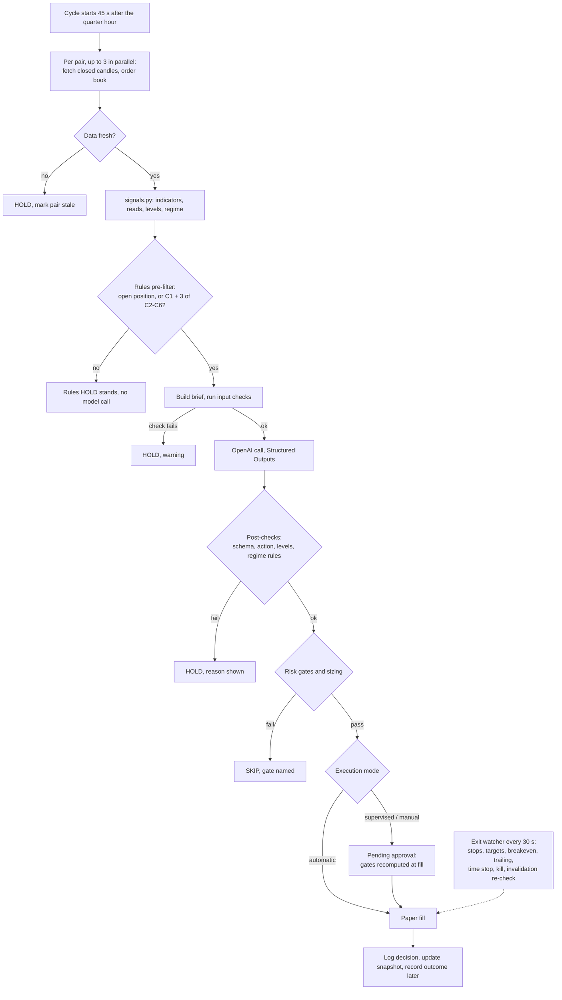

# Trading Agent v0.1 — Build Spec

Version: 10 Oct 2026 · Owner: Marc Nolte · Source of truth: this file (exported from the spec doc)

## Overview

v0.1 is a local web app, with a Python backend and a React frontend, that runs an autonomous crypto trading agent on paper. Every 15 minutes it reads live Bitvavo prices, computes signals in code, asks an OpenAI model for a decision when the rules see a possible setup or a position is open, checks that decision against hard risk limits, and fills it on a simulated account. The GUI shows what the agent sees, decides and holds, and lets Marc pause it, veto trades or flatten everything.

This document specifies the trading agent product. Devin implements it; the last sections give Devin the build order and acceptance tests.

**Goals**

- Trade a configurable set of Bitvavo EUR markets on paper (default nine: BTC, ETH, SOL, XRP, ADA, LINK, AVAX, DOGE and LTC, all against EUR), long-only spot, trading the 1-hour timeframe with 4-hour and daily context, checked every 15 minutes. Holding periods are hours to a few days. All prices, balances, fees and P&L are in euros; the only conversion is model cost, which OpenAI bills in USD.
- Use an OpenAI model as the decision layer, with every decision explained and logged.
- Enforce risk limits in code so the model can never exceed them.
- Give Marc full control from the GUI: pause, run now, approve or veto, stop and flatten.
- Produce a clean record of decisions and paper results to judge whether live trading is worth it, including what price did after every decision, taken or not.

**Non-goals for v0.1**

- Real orders or exchange API keys. The Live switch is shown but disabled.
- Shorting, leverage, futures or margin.
- Fear & Greed, news sentiment and on-chain flows. The input schema leaves room for them in v0.2.
- Hosting on a server. v0.1 runs on Marc's machine; the backend is built so it can move to a server later.

## Stack and architecture

A FastAPI backend in Python runs the agent and owns all state. A React frontend in the browser talks to it over REST plus one WebSocket. Both run on Marc's machine in v0.1, started with one command.

| Layer | Choice |
| --- | --- |
| Backend | Python 3.12, FastAPI, Uvicorn; the agent's asyncio scheduler runs in the same process |
| Indicators | numpy + pandas, no TA-Lib, so install stays simple |
| LLM | Official `openai` Python SDK, Responses API with Structured Outputs built from a Pydantic model |
| HTTP client | httpx (async) for Bitvavo |
| Validation | Pydantic v2 for API payloads, settings, model output and Bitvavo responses |
| Storage | SQLite via SQLAlchemy 2.0, migrations with Alembic |
| Secrets | `OPENAI_API_KEY` from the OS keyring (`keyring`) or a git-ignored `.env`; never in SQLite or logs; every external source's key is stored the same way |
| Frontend | React 18 + Vite + TypeScript, TanStack Query for REST, plain CSS tokens, no UI kit; TradingView Lightweight Charts (Apache 2.0) for the price and indicator panes |
| API types | Frontend types generated from FastAPI's OpenAPI schema with openapi-typescript |
| Tooling | uv for Python, ruff + mypy, pnpm for the frontend |
| Tests | pytest with pytest-asyncio and respx, Vitest, one Playwright end-to-end test |
| Run | `make dev`: Uvicorn with reload + Vite dev server. `make run`: builds the UI, FastAPI serves it on 127.0.0.1:8000 |

**Module layout**

```
backend/
  app/
    main.py               FastAPI app; lifespan starts and stops the engine; serves built UI
    api/routes.py         REST endpoints
    api/ws.py             WebSocket snapshot stream
    agent/
      engine.py           scheduler, cycle runner, 30 s exit watcher
      market/bitvavo.py   public candles, ticker, order book
      market/sim.py       seeded simulated market
      signals.py          RSI, EMA, ADX, VWAP, OBV, ATR, levels, structure
      brief.py            per-pair input for the model
      deciders/base.py    Decider protocol
      deciders/openai_decider.py
      deciders/rules.py
      risk.py             gates and sizing
      broker/paper.py     paper account, fills, fees, P&L
      market/universe.py  eligibility check with 3-day buffer, warming up
      outcomes.py         hourly outcome worker
      shadows.py          shadow runners with their own paper accounts
      budget.py           daily call limits and the monthly € cap
    features/
      quiet.py, risk_budget.py, readiness.py, insights.py
      whatif.py           replay with stored fills and Rules stand-ins
      ask.py              Ask panel with read-only tools
      briefings.py        morning briefing and weekly review, with the number check
    notify.py             browser and email alerts, repeat suppression
    jobs.py               scheduled jobs and their catch-up on wake
    glossary.yaml
    models.py             Pydantic: Decision, Position, Settings, Snapshot
    db.py, repo.py        SQLAlchemy tables + repositories
    config.py             settings and secrets loading
  config/models.yaml      model prices per million tokens
  prompts/decision.v1.md  system prompt, versioned
  tests/
frontend/
  src/                    React app
  src/api/schema.d.ts     generated from OpenAPI
Makefile, .env.example
```

Rules that hold everywhere:

- Signals, sizing, R/R and P&L are computed in Python. The model chooses an action and levels; it never computes money.
- Money uses `Decimal` for cash, fees and P\&L; floats only inside indicators.
- Both deciders implement one `Decider` protocol and return the same `Decision` model, so the GUI and risk layer don't care which one ran.
- Each pair is decided in its own call with only its own data, so one pair's inputs never leak into another's decision.
- The API binds to 127.0.0.1 only. Every write endpoint requires an `X-Local-Token` header generated at startup (the UI reads it from GET /api/session, which other sites can call but not read), so other sites open in the browser can't trigger trades.
- Every request must use Host 127.0.0.1 or localhost, which blocks DNS rebinding. The WebSocket accepts only connections whose Origin is the app itself, because browsers don't apply CORS to WebSockets and any open site could otherwise read the snapshot. No CORS headers are sent; in make dev, Vite proxies /api and /ws to the backend so the UI stays same-origin. Exactly one engine instance runs per database; Uvicorn runs with a single worker. Bind address, port, database path and data folder come from environment variables (TA_HOST default 127.0.0.1, TA_PORT 8000, TA_DB_PATH data/agent.db, TA_DATA_DIR data/; listed in .env.example), so the same build can later run on a VPS behind a reverse proxy without code changes.

## The agent cycle

Each cycle runs pair by pair: code gathers data and computes signals, the model proposes, and code checks the proposal before anything fills. The OpenAI model is consulted only when Rules sees a setup or a position is open.



Only a proposal that passes both the output checks and every risk gate reaches execution. A separate watcher closes positions on stops, targets or the kill drawdown without waiting for a cycle, the model or approval.

**Timing and time zones**

- Cycles start 45 seconds after each quarter hour (00:45, 15:45, 30:45, 45:45 past the hour; the offset is a setting), so the hourly candle has closed and Bitvavo has published it.
- If the newest closed 1h candle is not there yet, the cycle retries up to 3 times, 10 seconds apart, then holds that pair and marks it stale.
- Up to 3 pairs run in parallel within a cycle, each with only its own data, so nine pairs finish well within the interval; a cycle that is still running when the next is due makes the next one wait rather than overlap.
- Candles, daily bars, indicator windows and stored timestamps use UTC. The GUI shows Europe/Amsterdam time, and the daily loss limit resets at 00:00 Europe/Amsterdam.

## Indicator definitions

Every indicator is computed in `signals.py` on closed candles only, in UTC, exactly as defined here. The brief, the Indicators screen, the Rules engine and the signal-claims check all use these values, so they can never disagree.

| Indicator | Definition |
| --- | --- |
| EMA n | Standard exponential average of closes, seeded with the simple average of the first n closes; valid only after n + 50 bars |
| RSI 14 | Wilder's RSI on closes |
| ATR 14 | Wilder's average true range |
| ADX 14 | Wilder's ADX from +DI and −DI |
| ATR % | ATR ÷ close × 100 |
| ATR percentile | Rank of the current ATR % among the last 30 days of values on the same timeframe (1h: 720 bars, 4h: 180, 1d: 30) |
| VWAP | Rolling 24 bars: Σ(typical price × volume) ÷ Σ volume, typical price = (high + low + close) ÷ 3 |
| Price vs VWAP, vs EMA 200 | (close ÷ reference − 1) × 100 |
| OBV trend | (OBV now − OBV 20 bars ago) ÷ total volume of those 20 bars; range −1 to 1 |
| Volume × average | Volume of the last closed bar ÷ 20-bar simple average volume |
| Swing high / low | A bar whose high (low) is the highest (lowest) of the 3 bars on each side |
| Support and resistance | Swing levels from the last 200 1h bars and 120 4h bars, merged when within 0.3 × ATR(1h); the 3 nearest above and below price |
| Previous day high / low | High and low of the previous UTC day |
| Structure summary | Built from templates in code: consecutive closes above or below EMA 20; count of consecutive higher swing highs or lower swing lows; "range-bound for N bars" when the last N bars stay within 1.5 × ATR(1h) |
| Relative strength vs BTC | Pair return minus BTC-EUR return over 24h and 7d, in % |
| Correlation with BTC | Pearson correlation of 1h log returns over the last 30 days |
| EUR/USD move | Inverse of the USDC-EUR return over 1h and 24h, in % |

**Reads** (bullish / bearish / neutral): RSI above 55 or below 45; price vs VWAP and vs EMA 200 beyond ±0.1%; OBV trend beyond ±0.1; EMA 20 above or below EMA 50; ADX at 25 or more (≥ 25) is labelled trending, below 25 ranging. ATR % and ATR percentile read low below the 30th percentile, normal from the 30th to the 80th, high above the 80th. Volume × average reads high above 1.5, low below 0.7, otherwise normal. The ADX threshold of 25 is one config value, used by these reads, the regime, Rules condition C6 and Insights.

**Regime** (computed in `signals.py` for every pair and for BTC-EUR, stored with every decision):

- **Trend** from the latest closed 4h and 1d bars. *Up*: 4h ADX at least 25, 4h EMA 20 above EMA 50, and daily close above daily EMA 200. *Down*: 4h ADX at least 25, 4h EMA 20 below EMA 50, and daily close below daily EMA 200. *Sideways*: everything else, including 4h ADX under 25 or 4h and daily disagreeing.
- **Volatility** from the 1h ATR percentile: *low* below the 30th, *normal* 30th to 80th, *high* above the 80th.
- **Age**: closed 4h bars since the trend label last changed. A new trend label only takes effect after 2 closed 4h bars in a row agree, so the label doesn't flip on one bar.
- Example label: `up · normal · 14 bars`. The same label is used by the brief, the Rules engine, the Indicators screen, the decision drawer, Insights, the scorecard and What-if.

**History needed:** 1h candles are fetched with `limit=800` (about 33 days) so the 30-day percentile and correlation are complete; 4h and 1d with `limit=300`. If Bitvavo's endpoint caps the limit lower, page with `start` and `end`.

## Rules engine

A deterministic decider in `deciders/rules.py`. It is used three ways: as the pre-filter that decides whether the model is called, as the baseline every model decision is compared with, and as the fallback decider when there is no API key, the budget is spent, or the model fails.

**Conditions** (evaluated on the latest closed 1h bar)

| # | Condition |
| --- | --- |
| C1 | Higher-timeframe trend up: 4h EMA 20 above EMA 50, and daily close above daily EMA 200 |
| C2 | 1h EMA 20 above EMA 50 |
| C3 | 1h close above VWAP |
| C4 | 1h RSI between 45 and 70 |
| C5 | 1h OBV trend above +0.1 |
| C6 | 1h ADX at least 25 (the shared ADX threshold) |

**Pre-filter:** call the model when the pair has an open position, or when C1 holds and at least 3 of C2–C6 hold. Otherwise the Rules decision stands and no call is made.

**Rules BUY** (baseline and fallback): no open position, C1 holds, at least 4 of C2–C6 hold, and price is no more than 1.5 × ATR(1h) above 1h EMA 20, so it doesn't chase an extended move.

- Stop: lowest low of the last 6 1h bars minus 0.2 × ATR(1h), then widened to the fee gate's minimum distance if needed. If the resulting stop is more than 5 × ATR(1h) away, Rules does not BUY (SKIP).
- Target: nearest resistance above entry; if none within 6 × ATR(1h), entry + 2.5R.
- The risk gates then decide as for any BUY.

**Rules SELL** (only when holding, on top of the stop, target, breakeven and time-stop exits): 1h close below 1h EMA 50 with OBV trend below 0, or the 4h EMA 20 crossing below EMA 50.

Regime: Rules only BUYs when the pair's regime is up; in sideways and down it holds. **Confidence:** conditions met ÷ 6. **Reasoning:** a generated sentence listing which conditions held and which failed, so Rules decisions read like model decisions in the GUI.

All thresholds live in config, so the baseline can be tuned without code changes; each Rules decision stores the config version it used.

## OpenAI decision layer

The model gets one pair's market brief and returns a schema-checked decision; code then verifies every number it gave. Any failure means HOLD, never a trade.

**Configuration** (Settings → Decision model)

- Model id: free-text field, default gpt-4o-mini during development. Changing it takes effect next cycle. Prices per million input and output tokens for each model live in config/models.yaml; the cost estimate uses them, and an unknown model shows its cost as unknown instead of guessing.
- Decider: OpenAI (default) or Rules baseline. Rules also runs automatically when no API key is set. The OpenAI model is only called when Rules flags a possible setup or the pair has an open position; otherwise the Rules HOLD stands.
- Model parameters: temperature 0 and max\_output\_tokens 600, written in the header of the prompt file; changing them means a new prompt version, so replays, shadows and the scorecard always compare like with like. Timeout 30 s, one retry on network error or HTTP 5xx/429, no retry on invalid output.
- Daily call budget (default 1,000) for trading decisions, invalidation re-evaluations and replays. When reached, the agent switches to Rules and logs it. Ask has its own limit (100 questions a day), each shadow its own (default 300 calls a day), and briefings and weekly reviews (about 2 calls a day) count only toward the monthly cap. Monthly cost cap (default €10) over every model call: decisions, Ask, briefings, weekly reviews, shadows and replays. At 80% an alert is sent and shadows, Ask and replays pause, while briefings and reviews continue; at 100% decisions also fall back to Rules until the 1st of the next month. Costs are shown in euros, converted from OpenAI's USD prices with the day's rate from the USDC-EUR market; the inspector also shows the USD amount.

**Input: the market brief** (JSON, one pair per call)

| Field | Content |
| --- | --- |
| `pair`, `now`, `price` | Pair, ISO timestamp, last price in EUR |
| `tf.1h`, `tf.4h`, `tf.1d` | Per timeframe: RSI 14, EMA 20 and 50 (plus EMA 200 on 1d), ADX 14, price vs VWAP %, OBV trend, ATR 14 as % of price, ATR percentile vs the last 30 days, volume vs its 20-bar average. Every value comes with its read: bullish, bearish or neutral for RSI, EMA 20 vs 50, VWAP, OBV and EMA 200; trending or ranging for ADX; low, normal or high for ATR and volume |
| `structure` | Up to 3 support and 3 resistance levels from 1h and 4h swings, plus the previous day's high and low, each as % and ATR(1h) distance from price; a one-line pattern summary computed in code, e.g. "higher highs for 6 bars" |
| `market_context` | All computed from Bitvavo data: BTC-EUR 4h and 1d trend reads, 24h change and ATR percentile (volatility regime); relative strength vs BTC over 24h and 7d; ETH/BTC trend from ETH-EUR ÷ BTC-EUR; 30-day correlation of 1h returns with BTC; EUR/USD move over 1h and 24h from the USDC-EUR market, so a move caused by the euro is visible. The BTC brief omits the vs-BTC fields. Each field carries value, read, source and as-of time |
| `liquidity` | Spread %, order-book depth within ±0.5% of price in EUR, 24h volume vs its 30-day average |
| `position` | Null, or qty, entry, stop, target, hours held, unrealised %, best and worst move since entry in R |
| `pair_history` | Last 3 closed trades on this pair with result in R, and hours since the last exit |
| `previous_decision` | Last decision for this pair: action and invalidation only, not its reasoning |
| `account` | Exposure %, today's P&L %, drawdown % |
| `portfolio` | Pairs already held, each with its 30-day correlation to this pair and hours held; no prices, sizes or P&L from other pairs. Plus correlated slots left, whether the risk throttle is on, and whether the shock brake is on |
| `regime` | For the pair and for BTC: trend (up, down, sideways), volatility (low, normal, high) and age in closed 4h bars, all computed in code as defined under Indicator definitions. The BTC brief has one block |
| `limits` | min\_rr, min\_stop\_atr, max\_stop\_atr, min\_stop\_pct (from the fee gate) and max\_age\_s per timeframe (the freshness limits) |
| `time` | Hour in Europe/Amsterdam and weekday |
| `data_age_s` | Seconds since the newest closed candle closed (open timestamp + interval), per timeframe |

No raw candle arrays are sent: patterns are summarised in code, and values use relative units (%, ATR multiples) wherever possible. Sentiment and positioning (funding, open interest, long/short ratio, options data, Fear & Greed) and other external sources come after v0.1; see that section.

**Output schema** (Structured Outputs, `strict: true`)

```json
{
  "action": "BUY | SELL | HOLD",
  "confidence": 0.0,
  "entry": "number | null",
  "stop": "number | null",
  "target": "number | null",
  "reasoning": "max 600 chars, plain language",
  "signals": [{"name": "string", "tf": "1h|4h|1d", "read": "bullish|bearish|neutral|trending|ranging|low|normal|high"}],
  "invalidation": "what would prove this wrong",
  "invalidation_price": "number | null"
}
```

- BUY only when flat; SELL only when holding; anything else is rejected as invalid.
- `entry`, `stop`, `target` and invalidation\_price are typed number | null in the Pydantic model and the strict schema (every field is present; null is allowed). A BUY must give all four; other actions return null for entry, stop and target, and invalidation\_price is null when flat and not buying.

**Post-checks in code** (any failure → HOLD with reason shown in the GUI)

- Output parses against the Pydantic model the schema is generated from.
- On BUY: stop < entry < target, entry within 0.5% of last price, stop distance between 0.5 and 5 × ATR(1h).
- R/R is recomputed by code as (target − entry) / (entry − stop). The model's own claims about R/R are ignored. An R/R below the minimum is not a post-check failure: the Min reward/risk gate turns the BUY into SKIP. If the model's stop is closer than the fee gate's minimum distance, the fee gate turns it into SKIP; code never moves the model's stop. Regime rules are also enforced in code: a BUY while the pair's regime is down (other than BTC-EUR), or, in a sideways regime, a BUY whose entry is more than 1 × ATR(1h) above the nearest support or whose target is above the nearest resistance, becomes HOLD; confidence above its cap (0.7 in high volatility; 0.6 for a BTC-EUR BUY in a down regime) is lowered to the cap and flagged.

**Prompt**

- System prompt lives in `prompts/decision.v1.md`. Each decision stores the prompt version and model id.
- It defines the role (disciplined swing trader, long-only spot), the meaning of every brief field, and the rule to prefer HOLD when signals conflict across timeframes.
- It tells the model that stale data (any `data_age_s` beyond its timeframe's freshness limit) means HOLD.
- No few-shot trades in v0.1, to avoid anchoring on example prices.

**Draft of `prompts/decision.v1.md`** (the system prompt; the brief is sent as the user message)

```markdown
You are the decision layer of a paper-trading agent. You trade spot crypto against EUR, long only, on the 1-hour timeframe with 4-hour and daily context. Typical holding period: hours to a few days.

Each request contains one market brief for one pair, as JSON. Choose one action:
- BUY: only if there is no open position on this pair.
- SELL: only if there is an open position on this pair.
- HOLD: anything else. HOLD is the default; you are not rewarded for trading.

Reading the brief
- Indicators come as {"value", "read"}. Reads are computed in code with fixed thresholds. Use them as given; do not recompute or reinterpret them.
- Distances are in % of price and in multiples of ATR(1h).
- market_context describes BTC and the euro. If BTC's 4h and daily trends are down, require stronger evidence for any non-BTC BUY.
- A null field was unavailable. Never guess its value.
- portfolio lists coins already held and how closely each moves with this one. Code enforces the correlation limit, the shock brake and the risk throttle; mention them in reasoning when they matter, but do not try to work around them.
- If any data_age_s is above its limit in limits, the data is stale: answer HOLD.

BUY only when all of these hold
1. The 4h and daily trends are not down.
2. At least three of these 1h conditions hold: EMA 20 above EMA 50, price above VWAP, OBV bullish, RSI bullish, ADX trending.
3. A stop below a real level (a swing low or support) lies within limits.min_stop_atr to limits.max_stop_atr times ATR(1h), and at least limits.min_stop_pct % below price.
4. The nearest resistance leaves at least limits.min_rr times the risk.
5. Nothing in pair_history or previous_decision argues against it, such as a recent stop-out on this pair.

SELL when the reason for holding no longer holds
- The 1h trend has broken (close below EMA 50 with OBV falling), or the 4h trend has turned down.
- Do not SELL only because price moved against the position; the stop handles that.

Levels
- entry: the current price.
- stop: just beyond the level that would prove the trade wrong, not an arbitrary percentage.
- target: the nearest meaningful resistance, not a hope.
- Code recomputes risk/reward and sizes the trade. Never mention position size or euro amounts.

Regime
- regime gives trend (up, down, sideways), volatility (low, normal, high) and age in 4h bars, for this pair and for BTC. It is computed in code; use it as given.
- up: the BUY rules above apply.
- sideways: BUY only within 1 × ATR(1h) above a support level, with the target at or below the nearest resistance. Never BUY a breakout.
- down: HOLD. The only exception is BTC-EUR when every BUY rule holds; then confidence is at most 0.6.
- high volatility: confidence at most 0.7, and the stop goes beyond the nearest real level, not inside the noise.
- age below 6 bars: the regime just changed; require one more agreeing 1h signal than usual.
- When holding and the pair's regime turns down, say so in reasoning and consider SELL.

Confidence
- 0.5 means no edge. Go above 0.7 only when timeframes and signals clearly agree.

Signals
- List only signals that appear in the brief, with exactly the read the brief gives.

Reasoning
- Plain language, at most 600 characters, referring to fields in the brief.

Invalidation
- One concrete, observable condition that would prove the decision wrong.
- invalidation_price: the price at which that condition is met. On BUY it lies between the stop and entry; while holding, below the current price; when flat and not buying, null. Crossing it makes code ask you again at once.

Never
- Use information that is not in the brief.
- Change your standards because of the account's recent profits or losses.
```

The `limits` field in the brief carries `min_rr`, `min_stop_atr`, `max_stop_atr``, min_stop_pct and max_age_s per timeframe (the freshness limits)`, filled from Settings, so the prompt never hard-codes a number. Prompt changes are made by adding a new versioned file (`decision.v2.md`) and comparing it with replays before switching.

**Logging**

Each call stores the full request exactly as sent (model parameters, system prompt, brief, schema), the raw response exactly as returned, the parsed decision, post-check results, every retry attempt, OpenAI's request id, token counts, latency and cost estimate. The LLM inspector reads these records. The GUI shows today's call count and estimated spend.

## Risk gates

Every BUY passes all gates in `agent/risk.py` before it can execute; a failed gate turns it into SKIP with the gate named. Sizing is done here, never by the model.

| Gate | Default | Applies to | On fail |
| --- | --- | --- | --- |
| Min reward/risk | 2.0 | BUY | SKIP |
| Costs vs risk | Round-trip fees + slippage (about 0.6%) ≤ 30% of the stop distance, so stops at least about 2% away | BUY | SKIP |
| Risk per trade | 1.0% of equity | BUY sizing | Size reduced to fit |
| Total open risk | Σ max(0, entry − stop) × qty (a stop at or above entry counts as zero risk) over all open positions plus the new trade ≤ 2.5% of equity; the pairs move together, so this caps the combined bet | BUY sizing | Size reduced to fit; SKIP if below the market minimum or €10 |
| Max total exposure | 100% of equity: spot only, no leverage, so in practice available cash is the limit, and the 2.5% open-risk cap is the real risk limit | BUY sizing | Size reduced; SKIP if below €10 |
| One position per pair | on | BUY | SKIP |
| Cooldown after stop-out | 6 hours per pair | BUY | SKIP |
| Correlated positions | A BUY is skipped when the pair's 30-day correlation of 1h returns is above 0.8 with 2 or more open positions, so at most 2 closely correlated positions are open at once; BTC counts like any other pair | BUY | SKIP, naming the correlated positions |
| Shock brake | BTC-EUR moves more than 4% up or down within any 60-minute window (checked on the 30 s ticker), or any active pair's last closed 1h candle has a range above 3 × ATR(1h) | BUY | No new entries on any pair for 2 hours from the last trigger; exits keep working; alert |
| Risk throttle | After 3 losing trades in a row, or drawdown beyond 4% from peak: risk per trade 0.5% instead of 1%. Each trigger lifts on its own: the losing streak after the next winning trade, the drawdown once drawdown from the same peak is 2% or less. Risk is back to 1% when neither trigger is active | BUY sizing | Size halved; shown on the risk budget card |
| Cash available incl. fees | — | BUY | Size reduced; SKIP if below €10 |
| Data freshness | Newest closed candle at most one interval + 15 min old, measured from the candle's close (Bitvavo timestamps are open times, so close = timestamp + interval) (1h: 75 min; 4h: 4h 15m; 1d: 24h 15m) | all | HOLD, warn in GUI |
| Daily loss limit | −3% of day-start equity | BUY | No new entries until 00:00 Europe/Amsterdam |
| Kill drawdown | −8% from peak equity | all | Flatten all, Killed state, alert; see below |

**Sizing:** qty = (equity × risk %) ÷ (entry − stop), then capped by exposure, then by cash, rounded down to the pair's Bitvavo quantity precision.

**Exits the agent always takes, without the model or approval:**

- Stop hit: last price ≤ stop.
- Target hit: last price ≥ target.
- Breakeven: once price ≥ entry + 1R, stop moves to entry + fees. Trailing stop (setting, off by default): once price ≥ entry + 2R, the stop follows at the highest 1h close since entry minus 2 × ATR(1h), and never moves down. Try it in What-if or as a shadow before switching it on. Invalidation: if price crosses a position's stored invalidation price, the model is asked about that pair at once instead of at the next cycle; this is a re-evaluation, not an exit, and counts toward the daily call budget. It fires at most once per stored invalidation price: the new decision's invalidation price replaces it, and if the model returns none, nothing more fires until a later decision sets one. Time stop: a position still open after 5 days is closed at market.
- Kill drawdown or Stop & flatten button.

These are checked every 30 s on the ticker price, not only once per cycle, so a stop is never up to 15 minutes late.

**After the kill switch fires**

- The agent closes every position at market, enters the Killed state and sends an alert. Exits keep being watched; no new trades are possible.
- Resume is disabled until Marc acknowledges the kill in a dialog that shows the drawdown, the positions closed and when it happened.
- Acknowledging resets peak equity to current equity, so drawdown is measured afresh, logs the event, and moves the agent to Paused. Resume then works as normal.
- A paper-account reset also clears the Killed state.

## Market data and paper broker

Prices come from Bitvavo's public REST API with no key; fills happen on a local paper account that charges realistic fees.

**Market data** (`agent/market/bitvavo.py`)

- Base URL `https://api.bitvavo.com/v2` ([Bitvavo Node SDK docs](https://www.npmjs.com/package/bitvavo)).
- Candles: `GET /{market}/candles?interval=1h&limit=800` every cycle; `interval=4h` and `interval=1d` with limit=300 once per hour (enough history for EMA 200 on 1d). Each candle is `[timestamp, open, high, low, close, volume]` with prices as strings. Sort ascending by timestamp; don't assume order.
- Order book: `GET /{market}/book?depth=50` once per cycle, for spread and depth. USDC-EUR 1h candles are also fetched every cycle as the EUR/USD proxy; ETH/BTC is computed from the ETH-EUR and BTC-EUR candles already loaded.
- Ticker: `GET /ticker/price?market={market}` every 30 s for stops, targets and equity.
- The API is weight-limited per IP per minute. Read the rate-limit headers, back off on 429, and keep requests far below the limit.
- Drop the still-forming last candle before computing signals. Market rules per pair (minimum order size, price and amount precision) are loaded from GET /markets at startup and refreshed daily; sizing and paper fills always respect them.
- On any fetch error: mark the pair stale, skip it this cycle, show it in the GUI. Never decide on partial data.

**Supported markets** (`agent/market/universe.py`)

Any Bitvavo EUR market can be traded if it passes an eligibility check; Marc chooses which eligible markets are active.

| Rule | Threshold |
| --- | --- |
| 30-day average daily volume | at least €1M |
| Average spread over the last 24h | at most 0.15% |
| History | at least 300 daily candles (about 10 months), so the daily EMA 200 and the regime are valid |
| Type | not a stablecoin or fiat-pegged token (USDC, EURC, and similar) |
| Status on Bitvavo | trading, not halted or delisting |

- The check runs at startup and daily at 01:00 UTC, using Bitvavo's `/markets` and `/ticker/24h` plus stored candles. Thresholds live in config. To stop markets flipping in and out, an active market fails only after 3 days in a row below a threshold, or at once when it is 20% beyond it (for example under €0.8M volume); a failed market needs 3 days back within the thresholds to pass again. One alert per change, not per day.
- Default active set: BTC, ETH, SOL, XRP, ADA, LINK, AVAX, DOGE, LTC (all -EUR).
- A check that sees bad data keeps the previous result, and the check and the loading jobs are stored and shown on the Universe screen (v0.3 → Universe screen, item 026).
- Activating a market starts a history backfill; it shows Warming up and is not traded until 800 1h candles, 300 4h and 300 1d candles are loaded.
- If an active market fails the check, it shows a warning and an alert is sent. It stays active until Marc acts, but takes no new entries while failing.
- Deactivating a market stops new entries; an open position on it is still managed by its stop, target, time stop and the model until it closes.
- Each extra active market adds up to 96 model calls a day before the pre-filter; the Universe screen shows the estimate next to the daily budget (Settings did until item 026).

**Simulated market** (`agent/market/sim.py`)

- Same interface as Bitvavo. A seeded random walk with realistic volatility per pair.
- Used by tests and selectable in Settings for offline demos. The GUI shows a SIMULATED badge when active.

**Paper broker** (`agent/broker/paper.py`)

- Starting balance €10,000 (setting), EUR only.
- Market fills at last ticker price ± 0.05% slippage against you.
- Fee 0.25% per side (setting): Bitvavo's entry-tier taker fee for EUR markets, which applies under €100,000 of 30-day volume.
- Tracks cash, positions, realised and unrealised P&L, equity, peak equity and day-start equity.
- "Reset paper account" in Settings clears cash, positions, trades, equity and the Killed state after a confirm dialog and starts a new account number. Decisions, model calls, verdicts and outcomes are kept, tagged with the account they belonged to; Performance and Readiness count from the reset, and Insights can include earlier accounts. A separate "Delete all data" button wipes everything except settings and keys, after typing DELETE to confirm.

## GUI screens

The app has ten views (nine screens plus the Decision drawer; the design's 12 files add the Ask panel and a States and dialogs board), built to match the [Trading Agent GUI design canvas](https://claude.ai/artifact/Vorz1Hc5NGu547i6h1ViGU): Dashboard, Decision detail, Indicators, Performance, Insights, What-if, Reviews, Readiness, LLM inspector and Settings. All screens are in the design, plus the Ask panel, linked through a shared collapsible sidebar: logo, an Ask button, then the screens grouped as Monitor (Dashboard, Indicators, Performance), Learn (Insights, What-if, Reviews, LLM inspector) and Control (Readiness, Settings), each with an icon (Decision detail opens as a drawer), agent status and a collapse button. Collapsed, it shrinks from 232 px to a 72 px icon rail with tooltips; the choice is remembered per browser. Each screen keeps a slim top bar with its title and page actions. The separate States and dialogs board in the design shows: first run, stale data, Killed, the kill acknowledgement, confirm dialogs for Stop & flatten, reset and re-run, the supervised-mode approval queue with two pending trades, a browser notification, the monthly cost cap reached, the Ask limit reached, a What-if run in progress, Insights before there is enough data, and Delete all data. Sample numbers in the design are placeholders; every value comes from the agent snapshot.

**Visual system** (from the design)

- Dark only in v0.1. Ground #0B0E13, panels #12161D, lines #232A35, text #E7EAEE, muted #98A2AF.
- Accent amber #F2B94B for agent state. Up #3DD68C, down #FF6369; always paired with a sign or arrow, never colour alone.
- IBM Plex Sans for UI, IBM Plex Mono for every number. Bundle both fonts; no network fonts.
- Minimum hit target 44 px. Layout works from 1100 px wide, and from 390 px once PR 14 lands (see v0.3); the browser tab title shows agent status and today's P&L.

**Dashboard**

| Area | Contents and behaviour |
| --- | --- |
| Header | Status pill (Running / Paused / Killed / Error), Paper–Live switch (Live disabled with tooltip), Pause/Resume, Run cycle now, Stop & flatten (confirm dialog), Settings |
| KPI strip | Equity and % since start, today's P&L, exposure bar vs cap, drawdown bar vs kill level, next-cycle countdown and cycle number, today's model calls and est. cost |
| Chart | Pair selector with 24h change: tabs for the first 6 active pairs, the rest in a searchable More menu; 1h / 4h / 1d toggle; candlestick or line from cached candles; buy/sell markers from trades; open position's entry, stop and target as horizontal lines |
| Latest decision | Action badge, confidence, reasoning, signal chips, R/R, size, stop/target, decider + model id, Open full reasoning |
| Pending approval | Shown in supervised or manual mode: one card per pending trade, each with its own veto countdown, Approve and Veto. At fill, R/R, size and every gate are recomputed with the fill price, so two approvals together can never break the caps. A pending trade expires at that pair's next cycle, or earlier if price moves more than 0.5% from the planned entry |
| Positions | Pair, size, entry, last, stop, target, unrealised €, and a Close button per row |
| Activity | Newest first: cycle starts, decisions, skips with gate name, fills, exits, errors. Filter by pair |

**Decision detail** (drawer from the right)

- Header: cycle number, time, pair, decider, model id, prompt version, and the regime chips for the pair and BTC at that moment.
- Verdict with confidence bar; each risk gate with pass / warn / fail and its value.
- Signal table for 1h, 4h and 1d; the model's reasoning and invalidation text; entry, stop, target.
- Collapsible raw brief and raw model response (JSON) for prompt auditing.
- Prev / next to step through history; any past decision opens from the activity log.

**Indicators**

A screen in the main navigation to inspect every indicator the agent computes, per pair and timeframe, using exactly the values the brief uses. The frontend never recomputes an indicator; everything comes from `signals.py` through the API.

- **Selectors:** the same pair selector as the Dashboard and a 1h / 4h / 1d toggle. The window shows the last 300 bars, with zoom and pan.
- **Price pane:** candles with EMA 20, 50 and 200, VWAP, support and resistance levels, and the previous day's high and low as overlays. Each overlay can be switched on or off. Trades and decisions are marked on the bars where they happened.
- **Indicator panes below**, sharing the time axis: RSI with its 45 / 55 read bands, ADX, OBV, ATR as % of price with its 30-day percentile, and volume against its 20-bar average.
- **Crosshair:** hovering a bar shows every indicator's value and read at that bar.
- **Current values table:** one row per indicator with its value and read for 1h, 4h and 1d side by side, and the threshold that produced the read.
- **Context panel:** the structure summary text, levels with their distance in % and ATR, the BTC market context, and liquidity (spread, depth, volume). Regime: a strip above the price pane shows the pair's and BTC's current regime with its age, and a thin band under the candles colours each bar by its trend regime, so you can see when the label changed and why.
- **Data health:** bar count, age of the newest closed candle against its freshness limit, and any missing bars in the window.
- **As the model saw it:** "Open in Indicators" from a decision or an LLM inspector call shows the screen frozen at that moment, from the stored brief and candles, with the decision bar highlighted. A banner shows the timestamp and a button returns to live.
- **Export:** CSV of candles plus every indicator series for the visible window, to check the maths against another charting tool.

**Performance**

A screen in the main navigation that judges the paper account as a whole, answering "is this worth going live". The outcome scorecard judges decisions; this screen judges money.

- **Period:** 7 days, 30 days, since start, or a custom range.
- **Equity curve** from `equity_snapshots`, with a benchmark line: the account's starting balance held in BTC from the same start, so the agent is compared with simply buying and holding.
- **Drawdown chart** under the equity curve, with the kill level marked.
- **Totals:** return %, benchmark return %, max drawdown, number of trades, win rate, average R, profit factor, fees paid in €, and time in market %.
- **Per pair:** trades, realised P&L in €, average R, fees.
- **Closed trades table:** pair, opened and closed time, quantity, entry and exit price, fees, realised € and R, exit reason (target, stop, breakeven, time stop, model SELL, kill, manual), with a link to the opening decision.

**Settings**

From item 025 these settings are laid out and saved as in v0.3 → Settings screen.

- Markets: a table of Bitvavo EUR markets with 30-day volume, spread, history, eligibility and an Active switch, plus search to add one; ineligible markets show the failed rule; a footer shows active count and estimated model calls per day; cycles run every 15 minutes (fixed in v0.1; only the start offset is a setting). From item 026 the table is on the Universe screen and Settings keeps the thresholds.
- Execution: Automatic (default), Supervised (veto window 60 s), or Manual approval.
- Risk limits from the Risk gates table, each with validation and its unit.
- Decision model: decider, model id, prompt version, daily call budget, Rules pre-filter switch.
- Data source: Bitvavo live prices or Simulated. Paper account: starting balance, fee %, reset. Data sources and API keys: one row per source (OpenAI, Bitvavo market data, and every external source as it is added), showing what it is used for, whether a key is not needed, optional or required, an on/off switch, a masked key field with Test, Replace and Remove, the last successful fetch, and rate-limit usage. Sources planned for later appear disabled with their phase noted.
- Notifications: channels (browser, email with SMTP settings), a switch per event and channel, and Send test. Save applies on the next cycle. Unsaved changes show a bar with Save and Discard. Model costs: monthly € cap and this month's spend per feature. Learning and explanations: plain-language mode, quiet line, briefing time, weekly review day, Ask questions per day. Shadow strategies: up to 2, each with Compare, Promote (confirm) and Stop. Live readiness: the thresholds, with changes logged. Danger zone: Reset paper account and Delete all data.

**LLM inspector**

The inspector exists to debug the model: see exactly what it was fed, and judge whether its answer was correct for that input. It is a permanent screen in the main navigation, in development and in production, so every live decision stays auditable. In production, Re-run asks for confirmation because it spends a model call. From item 043 the screen's layout, filters, summary and call details follow v0.3 → LLM inspector, easier to read; what this section says about stored records, checks, replays and verdicts stays.

*Call list* (newest first, new calls appear live over the WebSocket)

| Column | Content |
| --- | --- |
| Time, cycle, pair | When and for which pair the call was made |
| Model, prompt version | Model id and system prompt version used |
| Status | OK, invalid output, timeout, API error, or retried |
| Latency | Milliseconds, including retries |
| Tokens | Input and output token counts from the API response |
| Est. cost | In euros at the day's rate, with the USD amount OpenAI bills |
| Final action | The action after post-checks and risk gates, e.g. BUY → SKIP (R/R gate) |

Filters: pair, status, date, has issues (any input or output check not passing), and your verdict. A "Show skipped" switch adds rows for cycles where the Rules pre-filter decided no call was needed, so gaps in the list are explained.

*Call detail*, two panes side by side

- **Input:** the request exactly as sent: model id and parameters, the full system prompt text, the market brief JSON (pretty-printed, collapsible), and the JSON schema used for Structured Outputs.
- **Output:** the raw response body exactly as returned, unaltered; the parsed decision; each post-check with pass or fail and its reason; token usage; OpenAI's request id; and every retry attempt with its error.
- **Actions:** copy any pane, download the whole call as one JSON file, and open the linked decision in the Decision drawer.

*Input checks* (run on the brief before the call, shown above the Input pane)

- Missing, null or NaN fields, and indicator values outside their valid range (RSI 0–100, ATR > 0, prices > 0).
- Stale data: any timeframe beyond its freshness limit (see Risk gates). Market-context fields have their own freshness limit per source; a missing or stale context field is sent as null with a reason and shown as a warning, not a block.
- Too little history for an indicator: fewer than n + 50 bars for EMA n, or fewer than 3 × the period for RSI, ATR and ADX.
- Cross-pair leak: any price in the brief more than 50% away from the pair's last price, which usually means another pair's data got in.

A failed input check means the call is not sent and the cycle holds; a warning is sent and shown. Either way you can tell bad input from a bad answer.

*Output correctness checks* (shown above the Output pane, each pass / warn / fail with its reason)

| Check | What it catches |
| --- | --- |
| Schema valid | Output doesn't parse into the decision model |
| Action allowed | BUY while holding, or SELL while flat |
| Levels sane | Stop not below entry, target not above, entry more than 0.5% from price, stop outside 0.5–5 × ATR(1h), invalidation price not between stop and entry on BUY, or not below the current price while holding |
| R/R recomputed | R/R from the model's levels below the minimum (shown for information; the action becomes SKIP at the Min reward/risk gate) |
| Signal claims vs input | Each signal the model cites is compared with the brief's actual value, using fixed reads: RSI > 55 bullish, < 45 bearish; price vs VWAP beyond ±0.1%; OBV trend beyond ±0.1; EMA 20 vs EMA 50; ADX trending at 25 or more; ATR low / normal / high at the 30th and 80th percentile; volume high above 1.5× and low below 0.7× its average. A claim that contradicts the input is a warn |
| Stale-data rule | Model traded although the brief marked data stale |
| Regime rule | BUY while the pair's regime is down (other than BTC-EUR), in a sideways regime an entry more than 1 × ATR(1h) above support or a target above resistance, or confidence above its cap (0.7 in high volatility, 0.6 for BTC-EUR in a down regime) |
| Rules baseline | What the Rules decider does on the same brief. Disagreement is shown as information, not as an error |

*Replay*

- "Re-run" sends the stored brief again, with the same or a different model id and prompt version, and shows the new output next to the original with differences highlighted.
- Replays are labelled as replays, never trade, and count toward the daily call budget.

*Your verdict*

- Mark any call Correct or Wrong, with an optional note on what was wrong.
- Verdicts are stored with the call and filterable. "Export labelled calls" downloads them as JSONL, to reuse as a test set when changing the prompt or model.

Nothing is redacted, because the API key is never part of the stored request. The inspector reads only stored records, so opening it never triggers a model call.

## User features

Eleven features that reduce confusion, anxiety and guesswork for the person running the agent. One rule applies to every feature that writes text with a model (Ask, briefing, weekly review): **numbers come from code, the model only writes prose**. Each output is checked so that every number in the text appears in the facts it was given; if not, the text is regenerated once, then replaced by a plain template.

**Understanding the agent**

1. **Ask the agent.** A chat panel opened from the sidebar on every screen. Questions like "Why didn't you buy SOL yesterday?" are answered by an OpenAI model with read-only tools: `get_decisions`, `get_trades`, `get_outcomes`, `get_llm_call`, `get_performance`, `get_indicators_at`, `get_settings`, `get_activity`. Every answer cites the records it used as links (decision, trade, call). It cannot change settings, trade or pause anything; if the records don't answer the question it says so. Further read-only tools: get\_snapshot (risk budget, quiet line, pauses), get\_insights, get\_readiness and get\_glossary, so "What does fee gate mean?" is answered from the glossary. Limited to 100 questions a day (setting) and to the monthly cost cap; one question may use several model calls, each logged in the LLM inspector. Conversations are stored locally and listed inside the panel. The panel slides in from the right over the current screen and receives that screen's context (for example the open decision).
2. **"Why so quiet?" status.** A one-line explanation on the Dashboard, computed in code each cycle, no model: time since the last trade, how many pairs failed which pre-filter condition, how many reached the model and what it decided, and the gates that blocked trades. Active brakes and pauses are added at the end, global ones first: the shock brake, a pause on all entries, then per-coin pauses (for example "Shock brake on until 16:30. All new entries paused until 14:00. DOGE paused for 18h."). Example: "Quiet: 7 of 9 pairs failed the trend filter (4h down). 2 reached the model; both held. Last trade 31h ago."
3. **Plain-language mode.** A `glossary.yaml` with a one-to-two-sentence definition per term (R, ATR, drawdown, flatten, exposure, VWAP, OBV, ADX, pre-filter, fee gate, and so on). Terms in the UI get a dotted underline and a tooltip; there is no separate Glossary page; Ask answers "what does X mean?" from the same file. On by default; switch in Settings.
4. **Daily briefing.** At 08:00 Europe/Amsterdam (default; the time is a setting) the agent writes a 150–250 word note from a summary computed in code: trades opened and closed, P&L vs BTC, open positions and their distance to stop and target, notable SKIPs, alerts, and the 3 pairs closest to a setup. Shown as a card on the Dashboard and sent by email; it replaces the plain daily summary email. If there is no OpenAI key, the model call fails or the monthly cost cap is reached, the computed facts are rendered with the plain template instead: the card and email still appear, labelled with the reason (for example "Plain briefing: no OpenAI key"), and the failure is logged. Weekly reviews follow the same rule.

**Trust and safety**

5. **Live-readiness checklist.** A Readiness screen with criteria that must all pass before the Live switch can be unlocked (live trading itself is a later phase). Defaults, editable in Settings: at least 100 closed trades; at least 30 days of paper trading; return above BTC buy-and-hold after fees over the same period; max drawdown under 6%; average R above +0.2 after fees; profit factor above 1.3; confidence calibration within 10 percentage points (BUYs grouped by stated confidence into 0.5–0.6, 0.6–0.7, 0.7–0.8 and 0.8+; per bucket the gap between average stated confidence and actual win rate; gaps averaged weighted by bucket size, skipping buckets with fewer than 10 BUYs; cannot pass before 50 BUYs); no kill-switch event in the last 30 days; no unresolved errors in the last 7 days (only errors that affected a decision or a fill; see Operations; from PR 15 the criterion in v0.3 → Logging, errors and the Logs screen). Each criterion shows its current value, target, pass or fail, and for counts an estimated date at the current pace. Criteria count from the current paper account. Any threshold change is kept in the settings history; a loosened threshold is shown on the screen with its date.
6. **Per-coin pause.** Pause new entries on one coin, or on all coins, for 1 hour, 24 hours, until a date and time, or until resumed. Exits and the model's SELL decisions keep working; pauses expire automatically, show a clock badge on the pair, and are logged. Set from the pair selector, the latest-decision card or the Universe table (the Settings markets table until item 026); Ask cannot set it. While a pair's entries are paused and it has no open position, the model is not called for it (shadows included): the Rules engine answers, any BUY ends as SKIP at the Entry pause gate, and no call budget is spent. With an open position the model is called as usual, so SELL decisions keep working. The Entry pause gate is checked again when a pending approval fills.
7. **Risk budget meter.** A Dashboard card that also shows, when active, the risk throttle (0.5% per trade and what lifts it), the shock brake (and when it ends) and the correlated slots left, plus three bars: open risk vs the 2.5% cap, today's loss vs the 3% daily limit, drawdown vs the 8% kill level; plus one line such as "Room for about 2 more full-size trades".

**Improving with evidence**

8. **What-if simulator.** A screen that re-runs a stored period with changed settings: risk gates, Rules thresholds, min R/R, fee gate, max hold, cooldown, total risk cap, correlation limit, shock brake, risk throttle, trailing stop and active pairs. Model decisions are held fixed (no new calls), and so are human choices: a decision that was vetoed, expired or still pending in reality never fills in a scenario. A scenario can block a real fill, or fill a decision that a gate skipped in reality, but never overrides a veto or an expiry; Rules decisions, gates, sizing, fills and outcomes are recomputed from stored candles. When a scenario reaches a pair and cycle the model never saw (looser Rules thresholds, or an added coin), the Rules decision stands in; those trades are marked "Rules stand-in" and the results show how many there are. Fills: a trade that matches a real one uses the stored real fill prices; other exits are checked on 1h candles, stop first when one candle touches both levels. Every real fill and every 30-second price check within 0.5% of a stop or target is stored (exit\_ticks), so a run with unchanged settings reproduces the actual results exactly. Results: equity curve vs what actually happened, changed metrics, and the trades added or removed. A banner explains that the model's answers are held fixed. Scenarios can be saved; "Apply these settings" asks for confirmation.
9. **Insights.** A screen that slices outcomes and trades by pair, hour of day, weekday, regime (the stored trend and volatility label), volatility percentile bucket, confidence bucket, decider and prompt version. Metrics: count, BUY win rate, average R, missed vs avoided. Includes a calibration chart: stated confidence vs actual win rate. A slice needs at least 30 decisions to count as a finding; slices with 10–29 show greyed as "early signal", and slices under 10 are hidden. Weekly reviews and suggestions only use findings. Before there is enough data the screen says how many more decisions are needed.
10. **Shadow strategies.** Up to 2 shadows, each a model id, prompt version and optional settings overrides. A shadow gets the same briefs as live every cycle: built from the same cycle snapshot (candles, indicators, regime, timestamps), with the position and account block taken from the shadow's own paper account, so a shadow holding a position can get SELL answers. Like live, it calls the model when its pre-filter passes or when it holds a position on the pair, and its gates (correlation, open-risk cap, throttle, cooldown) use its own account. It never trades, keeps its own paper account and outcomes, and appears in the scorecard, Insights and What-if. Its account starts flat, with cash equal to the live account's equity at creation; the start equity and creation time are stored, and Compare measures live's return from that same moment. Each shadow has its own daily call limit (default 300) and pauses first when the monthly cost cap reaches 80%: it then makes no new decisions (no Rules stand-in) until the 1st of the next month or until the cap is raised, while the watcher keeps managing its open positions. The pause window is stored, shown in Compare and left out of both sides' return and drawdown comparison. A shadow's settings overrides also apply to its own Rules pre-filter, so it may call the model on cycles where live did not. Its stops, targets and time stops are checked by the same 30-second watcher against its own paper account. Promote replaces the live model or prompt after a confirmation.
11. **Weekly review.** Every Monday 08:00 (default; day and time are settings) a report page and email: the week's metrics vs the previous week and BTC, the 3 best and worst trades with links, patterns in decisions marked Wrong (grouped by which output check fired), insights that changed with enough data, and one evidence-backed suggestion with a "Try in What-if" link. Past reviews are kept on a Reviews screen.

## Outcome tracking

After every decision the agent records what price actually did, so decisions are judged by results rather than by how convincing the reasoning sounded. It covers every decision: BUY, SELL, HOLD, SKIP, and cycles held by the Rules pre-filter.

**What is measured**

| Decision | Reference levels |
| --- | --- |
| BUY (executed) | The real entry, stop and target, and the realised result in R after fees once the trade closes |
| BUY turned SKIP, or BUY rejected by checks | The levels the model proposed |
| HOLD, pre-filter hold | A hypothetical long at the decision price: stop 1.5 × ATR(1h) below, target 2R above |
| SELL | Price change after the exit, to show whether selling was early or right |

For each decision, at 4h, 24h and 72h after it:

- Forward return in %.
- Best and worst move in % and in R (maximum favourable and adverse excursion).
- First touch: target first, stop first, or neither within 72h. Measured on closed 1h candles; when one candle touches both, it counts as stop first. Invalidation: whether price crossed the model's invalidation price within 72h, and what price did in the 24h after the cross, to judge whether those levels were sensible.

**Labels derived from it**

- BUY: win or loss by first touch, or "open" when neither level is touched within 72h; plus realised R for executed trades.
- HOLD or SKIP: "avoided" if the hypothetical stop hit first, "missed" if the target hit first, "flat" otherwise.
- SELL: "good exit" if price is lower after 24h, "early exit" if it is more than 1R higher, "neutral" in between. Here 1R is the position's original risk per unit (entry fill price minus the stop set at entry), never the stop at exit time, which may sit at breakeven or be trailed. "After 24h" is the close of the last closed 1h candle at exit + 24h, compared with the exit fill price.

**How it runs**

- An outcome worker in the backend runs every hour, fills every outcome whose horizon has passed, and backfills after downtime. It is idempotent, and each record stores the method version.
- Bitvavo 1h candles are the source; closed candles never change, so results are reproducible.
- Stored in an `outcomes` table: decision id, horizon, measures, label, computed at, method version.

**Where it shows**

- Decision drawer and LLM inspector: the outcome next to the decision, or "pending until" with the time. Your verdict judges the reasoning; the outcome judges the result; both are shown side by side.
- LLM inspector: filter by outcome label, and a scorecard per decider, model and prompt version: number of decisions, BUY win rate, average R, and missed versus avoided for HOLD and SKIP.
- Exports: outcomes are included in the JSONL and CSV exports, next to the brief, so the data can later train or test a model.

## Data model and API

The backend owns all state and pushes a full `Snapshot` to the UI over the WebSocket after every change; the UI never computes trading values itself.

**Core types** (`app/models.py`)

```python
Action = Literal["BUY", "SELL", "HOLD", "SKIP"]
ExecMode = Literal["auto", "supervised", "manual"]

class Signal(BaseModel):
    name: str
    tf: Literal["1h", "4h", "1d"]
    read: Literal["bullish", "bearish", "neutral", "trending", "ranging", "low", "normal", "high"]

class Gate(BaseModel):
    name: str
    status: Literal["pass", "warn", "fail"]
    value: str

class Plan(BaseModel):
    entry: Decimal; stop: Decimal; target: Decimal
    qty: Decimal; notional: Decimal; rr: Decimal

class Decision(BaseModel):
    id: str; cycle: int; at: datetime; pair: str
    decider: Literal["openai", "rules"]
    model: str | None = None; prompt_version: str | None = None
    action: Action; confidence: float
    reasoning: str; invalidation: str | None = None
    signals: list[Signal]; plan: Plan | None = None; gates: list[Gate]
    status: Literal["executed", "pending", "approved", "vetoed", "expired", "none"]
    execute_at: datetime | None = None; error: str | None = None
    regime: Regime; btc_regime: Regime    # trend, volatility, age_4h
    invalidation_price: Decimal | None = None
    risk_pct_used: Decimal                # 1.0 normally, 0.5 when throttled
    account_id: int; settings_version: int
    shadow_id: str | None = None          # None = live
    stand_in: bool = False                # What-if only: Rules answered for a missing model call

class Position(BaseModel):
    pair: str; qty: Decimal; entry: Decimal; stop: Decimal; target: Decimal
    opened_at: datetime; decision_id: str; last: Decimal; unrealised: Decimal

class Snapshot(BaseModel):
    status: Literal["running", "paused", "killed", "error"]
    mode: Literal["paper"]; source: Literal["bitvavo", "sim"]
    cycle: int; next_run_at: datetime | None; cycle_in_progress: bool
    equity: Decimal; cash: Decimal; start_equity: Decimal; today_pnl: Decimal
    exposure_pct: float; drawdown_pct: float
    prices: dict[str, PriceInfo]          # last, chg_24h_pct, stale
    positions: list[Position]; latest: dict[str, Decision]; pending: list[Decision]
    activity: list[ActivityItem]          # at, kind, pair, text, decision_id
    usage: Usage                          # calls_today, cost_today_eur, cost_month_eur, cap_eur
    account_id: int
    quiet: str                            # the "Why so quiet?" line
    risk_budget: RiskBudget               # open risk, today's loss, drawdown, each with limit; full-size trades left
    paused: list[EntryPause]              # pair or "*", until
    errors_24h: int; errors_open: int
    kill: KillInfo | None                 # set while Killed, for the acknowledgement dialog

class RiskBudget(BaseModel):
    open_risk_pct: Decimal; open_risk_cap_pct: Decimal
    today_loss_pct: Decimal; daily_limit_pct: Decimal
    drawdown_pct: Decimal; kill_pct: Decimal
    full_trades_left: int                 # min(open-risk room, cash room), at a 3% stop
    risk_pct_now: Decimal                 # 1.0, or 0.5 while throttled
    throttle: Throttle | None
    shock_brake_until: datetime | None
    correlated_slots_left: int

class Throttle(BaseModel):
    reasons: list[Literal["streak", "drawdown"]]; lifts_when: str

class KillInfo(BaseModel):
    at: datetime; peak: Decimal; equity: Decimal; drawdown_pct: Decimal
    closed: list[str]                     # pairs closed by the kill

class Regime(BaseModel):
    trend: Literal["up", "down", "sideways"]
    volatility: Literal["low", "normal", "high"]
    age_4h: int

class PriceInfo(BaseModel):
    last: Decimal; chg_24h_pct: Decimal; stale: bool

class ActivityItem(BaseModel):
    at: datetime; kind: str; pair: str | None; text: str; decision_id: str | None

class Usage(BaseModel):
    calls_today: int; daily_budget: int
    cost_today_eur: Decimal; cost_month_eur: Decimal; cap_eur: Decimal

class EntryPause(BaseModel):
    pair: str                             # "*" = all coins
    until: datetime | None
```

The snapshot also carries `quiet` (the "Why so quiet?" line), `risk_budget` (open risk, today's loss and drawdown, each with its limit, plus the number of full-size trades that still fit) and `paused` (per-coin and global entry pauses with their expiry). New tables: `briefings` (daily and weekly, with their computed facts), `ask_conversations`, `whatif_scenarios`, `shadows` and `shadow_decisions`.

Decimals are serialised as strings in JSON; the frontend formats them and never does arithmetic on money.

**SQLite tables:** `settings`, `decisions` (with raw brief and raw response), `trades`, `positions`, `equity_snapshots` (one per cycle), `activity`, `llm_calls`, candles (every closed 1h, 4h and 1d candle per market, read by the Indicators replay, What-if and outcomes), exit\_ticks (prices at real fills and near-stop or near-target checks, for What-if), settings\_history (every change with time, old and new value; decisions store the settings version), accounts (one row per paper account; trades, decisions and outcomes carry account\_id), entry\_pauses, alerts (sent alerts, for the 30-minute repeat rule) and errors (with affected decision or fill, resolved\_at and note). Item 026 adds `market_checks` and `sync_runs` (v0.3 → Universe screen).

Outcome tracking adds an `outcomes` table, described in its own section.

**Source registry:** each data source module declares a descriptor: id, name, purpose, key requirement (none, optional or required), whether it is enabled, its freshness limit and rate limit. The Settings page and `GET /api/sources` are built from these descriptors, so adding a source needs no new UI. A required key that is missing disables the source with a clear message instead of failing cycles.

**API** (FastAPI on 127.0.0.1:8000; every POST and PUT needs the `X-Local-Token` header, which the served UI receives at load)

| Endpoint | Effect |
| --- | --- |
| `GET /api/snapshot` | Current snapshot, including quiet status, risk budget and pauses |
| `WS /ws` | Sends two message types: {"type": "snapshot"} after each change, and {"type": "alert"} with event, title, text and link for every alert whose browser channel is on (the frontend shows these with the Notification API). The client reconnects with backoff and refetches the snapshot on reconnect |
| `GET /api/health` | Engine state, last cycle, source status, errors in the last 24h |
| `POST /api/agent/pause`, `/resume` | Stop or restart the scheduler; exits still run while paused; resume is refused while Killed |
| `POST /api/agent/run-now` | Start a cycle now if none is running; 409 if one is |
| `POST /api/agent/flatten` | Close every position at market and pause |
| `POST /api/agent/acknowledge-kill` | Confirms the kill, resets peak equity to current equity, moves to Paused |
| `PUT /api/agent/entry-pause`, `DELETE /api/agent/entry-pause` | Pause or resume new entries on all coins, with an optional `until` |
| `POST /api/positions/{pair}/close` | Close one position at market |
| `POST /api/decisions/{id}/approve`, `/veto` | Resolve one pending decision; R/R, size and gates are recomputed at the fill price; 409 if it has expired |
| `GET /api/markets` | Every Bitvavo EUR market with 30-day volume, spread, history, eligibility, the failed rule if any, active, warming-up and paused state |
| `PUT /api/markets/{market}` | Activate or deactivate a market; activation is refused with the failed rule when ineligible. From item 026 the Universe screen uses it, with the looser confirmation of the Settings screen |
| `GET /api/universe`, `GET /api/universe/check`, `GET /api/universe/sync`, `POST /api/universe/sync/{job}/retry` | The Universe screen, its check runs and its sync jobs (item 026; v0.3 → Universe screen) |
| `PUT /api/markets/{market}/pause`, `DELETE /api/markets/{market}/pause` | Pause or resume new entries on one coin, with an optional `until` |
| `GET /api/candles/{pair}?tf=1h` | Cached candles plus trade markers for the dashboard chart |
| `GET /api/indicators/{pair}?tf=1h&bars=300&at=` | Candles plus every indicator series, current values and reads, levels, context and data health. With `at` (a decision or call id) it returns the stored state from that moment |
| `GET /api/indicators/{pair}/export.csv?tf=&from=&to=` | Candles and indicator series as CSV |
| `GET /api/performance?from=&to=` | Equity curve, BTC buy-and-hold benchmark, drawdown series, totals and per-pair figures |
| `GET /api/trades?pair=&from=&to=` | Closed trades with fees, realised € and R, and exit reason |
| `GET /api/readiness` | Every live-readiness criterion with value, target, status and estimated date |
| `GET /api/insights?dimension=&from=&to=&decider=&prompt_version=` | Outcome and trade metrics sliced by one dimension, with sample sizes; `dimension=confidence` returns the calibration data |
| `POST /api/whatif` | Starts a simulation for a period and settings overrides; returns a job id |
| `GET /api/whatif/{id}` | Progress, then equity curves, metric changes and added or removed trades |
| `POST /api/whatif/{id}/save`, `/apply` | Save the scenario, or apply its settings after confirmation |
| `GET /api/shadows`, `POST /api/shadows`, `DELETE /api/shadows/{id}` | List, create (model, prompt version, overrides) or stop a shadow strategy |
| `POST /api/ask` | A question plus optional conversation id; returns the answer with cited records |
| `GET /api/ask/conversations` | Stored conversations |
| `GET /api/briefings?type=daily\|weekly`, `GET /api/briefings/{id}` | Daily briefings and weekly reviews with their computed facts |
| `GET /api/glossary` | All glossary terms and definitions |
| `GET /api/decisions/{id}` | Full decision incl. raw brief, response and outcome |
| `GET /api/decisions?pair=&outcome=&before=` | Paged history for the drawer and activity log |
| `GET /api/outcomes/stats?group=decider,model,prompt_version,shadow&from=&to=` | Scorecard: decisions, BUY win rate, average R, missed vs avoided for HOLD and SKIP |
| `GET /api/llm-calls?pair=&status=&issues=&verdict=&outcome=&before=&skipped=` | Paged LLM call list for the inspector. From item 043 also the filters, cursor and total of v0.3 → LLM inspector, easier to read, with `GET /api/llm-calls/summary` and `GET /api/llm-calls/export.csv` |
| `GET /api/llm-calls/{id}` | One call: request as sent, raw response, parsed decision, input and output checks, attempts, verdict, outcome |
| `GET /api/llm-calls/{id}/download` | The same record as a downloadable JSON file |
| `POST /api/llm-calls/{id}/replay` | Re-sends the stored brief with an optional model id and prompt version; returns the replay record, never trades |
| `PUT /api/llm-calls/{id}/verdict` | Sets Correct or Wrong plus an optional note |
| `GET /api/llm-calls/export.jsonl?verdict=&outcome=` | Labelled calls with outcomes as JSONL |
| `GET /api/settings`, `PUT /api/settings` | Validated by Pydantic; invalid input returns 422 with field errors. From item 025 a save needs a reason and makes a settings version (v0.3 → Settings screen), with `GET /api/settings/meta` and `POST /api/settings/preview` |
| `GET /api/notifications`, `PUT /api/notifications` | Channels, SMTP settings (password excluded) and per-event switches |
| `POST /api/notifications/test` | Sends a test message to every enabled channel |
| `GET /api/sources` | Every data source with purpose, key requirement, key set (last 4 only), enabled, last success, rate-limit usage |
| `PUT /api/sources/{id}` | Enable or disable a source |
| `PUT /api/secrets/{source}`, `DELETE /api/secrets/{source}` | Store or remove a key in the keyring (also the SMTP password); the secret is never returned |
| `POST /api/secrets/{source}/test` | One minimal request with the stored key; returns ok or the provider's error message |
| `POST /api/paper/reset` | Starts a new paper account (cash, positions, trades, equity, Killed state); keeps decisions, calls, verdicts and outcomes |
| `DELETE /api/data` | Wipes all data except settings and keys; requires {"confirm": "DELETE"} |
| `GET /api/activity?pair=&kind=&before=` | Paged activity log, filterable by pair and kind (e.g. kind=error for the error badge link) |
| `GET /api/whatif` | Saved What-if scenarios with their settings and last results |
| `POST /api/shadows/{id}/promote` | Makes the shadow's model and prompt version live after confirmation; the shadow stops; logged in the settings history |
| `GET /api/ask/conversations/{id}` | One stored conversation with its questions, answers and cited records |
| `GET /api/prompts` | Available prompt versions with their model parameters, for Settings, Re-run and shadows |
| `POST /api/maintenance/prune` | Deletes raw briefs and responses older than 90 days; keeps parsed decisions and outcomes |
| `GET /api/session` | The X-Local-Token for the served UI; no CORS headers, so other sites cannot read it |
| `GET /api/errors, PUT /api/errors/{id}/resolve` | Open and resolved errors; dismiss one with a note |
| `GET /api/costs?month=` | Model spend in € per feature (decisions, Ask, briefings, shadows, replays) against the monthly cap |
| `GET /api/settings/history` | Every settings change with time, old and new value; from item 025 grouped in versions with their reason |
| `GET /api/export/{decisions,trades}.csv` | CSV export, outcomes included |

## Settings, secrets and persistence

Everything the agent knows survives a restart, and it always restarts paused.

- **Restart behaviour:** when the backend starts it loads state from SQLite, refreshes prices, re-checks stops and targets on open positions, and waits in Paused until Marc presses Resume. A pending decision from before the restart is marked expired.
- **Settings** live in the `settings` table as one validated JSON document with a schema version. Defaults are in code; unknown keys are dropped on load. From item 025 every save is a settings version with a reason (v0.3 → Settings screen).
- **API key:** read from the OS keyring via `keyring`, falling back to `OPENAI_API_KEY` in a git-ignored `.env`. Every external source's key is handled the same way: stored per source in the keyring, with a .env fallback named after the source (for example COINGECKO\_API\_KEY). The frontend only ever sees whether a key is set and its last 4 characters. Keys are never logged and never appear in decision records, LLM briefs or exports.
- **Retention:** keep all decisions, trades and LLM calls. Raw briefs and responses older than 90 days may be pruned by a Settings button.
- **Export:** CSV of decisions and trades via the export endpoints.
- **Single engine:** the backend takes an exclusive lock file next to the database at startup and refuses to start if another instance holds it, so two agents never trade the same account.
- **Sleep and wake:** if the scheduler wakes more than one interval late, it skips missed cycles and runs one fresh cycle; it never replays them. Other scheduled jobs catch up once on start or wake: a missed morning briefing runs if it is within 4 hours of its scheduled time, otherwise it is skipped; a missed weekly review runs the same week; the eligibility check, outcome worker and backup run when their last run is older than their interval.

**Notifications**

| Event | Browser | Email |
| --- | --- | --- |
| Kill switch fired | on | on |
| Daily loss limit reached | on | on |
| Pair stale for 2 cycles in a row | on | off |
| Data source failing (3 failures in a row) | on | off |
| Model failing (3 calls in a row), daily budget reached, or monthly cost cap at 80% or 100% | on | on |
| Trade opened or closed | off | off |
| Shock brake on, or risk throttle on or lifted | on | off |
| Morning briefing and weekly review, at their configured times (replace the plain daily summary) | off | on |

- Browser notifications use the Notification API and work while the app is open in a tab; the app asks for permission on first use.
- Email goes over SMTP: host, port, TLS, username, sender and recipient in Settings; the SMTP password is stored in the keyring like every other secret.
- Each event can be switched per channel. The same alert is sent at most once per 30 minutes, with a count of repeats.
- "Send test" sends one test message to every enabled channel.

**Operations**

- Logs: structured JSON lines in `logs/app.log`, rotated at 10 MB, 5 files kept. Secrets are never logged. From PR 15 replaced by v0.3 → Logging, errors and the Logs screen (logs in `data/logs/logs.db`).
- Errors (until PR 15; then recurring problems on the Logs screen): every error also lands in the activity log with kind "error"; the header shows an error badge with the count of the last 24h, linking to the filtered activity log. An error resolves itself when its cause has not recurred for 1 hour (for example a source that recovers); others are dismissed with a short note from the activity log. Errors that affected a decision or a fill are flagged and count for Readiness.
- Backups: a daily copy of the SQLite database at 03:00 using SQLite's backup API, into `backups/` inside the data folder, keeping the last 14.
- Health: `GET /api/health` reports engine state, last cycle, source status and recent errors, for later monitoring on the VPS.

## Testing and acceptance criteria

v0.1 is done when every item below passes on the simulated market, and the app runs for 24 hours on live Bitvavo prices without an unhandled error.

**Unit tests (pytest; Vitest for UI formatting helpers)**

- Indicators match reference values for RSI, EMA, ATR, VWAP and OBV on a fixed candle fixture.
- Risk gates: each gate passes and fails at its boundary. Sizing never exceeds risk %, exposure cap or cash.
- Model output: invalid JSON, wrong action for position state, stop above entry, and entry far from price end as HOLD with the post-check named, except R/R below the minimum, which ends as SKIP with the gate named.
- OpenAI client: timeout, 429 and 5xx retry once, then HOLD. Mock the SDK; no real calls in CI.
- Paper broker: fees and slippage applied on both sides; equity = cash + positions at last price.

**Engine tests (simulated market, fake clock)**

- 2,000 cycles run with no NaN anywhere in the snapshot. The total-open-risk cap sizes down a third concurrent full-size position (at 1% each, the third gets 0.5%; the test uses stops 4% away so cash is not the limit); a position open for 5 days closes by time stop; a stop-out blocks re-entry on that pair for 6 hours; Resume is refused while Killed until the kill is acknowledged; a cycle that finds no closed candle retries and then holds. A market below the eligibility bar cannot be activated, and a newly activated market shows Warming up until its history is loaded.
- A forced −8% drawdown flattens all positions and enters Killed within one ticker check; Resume is refused until the kill is acknowledged.
- A stop is hit between cycles and closed within 30 s of the price crossing it.
- Supervised mode executes after the veto window; veto prevents the fill; manual mode waits until the pair's next cycle, then expires; a pending trade expires early when price moves more than 0.5% from its planned entry.
- Restart mid-cycle resumes Paused with positions and history intact. The outcome worker labels a candle fixture correctly, counts stop first when one candle touches both levels, and backfills missed horizons after downtime.

**Acceptance checklist**

- [ ] Fresh install starts Paused, with Rules decider and no API key, and runs a cycle on Resume.
- [ ] With a key set, decisions show decider OpenAI, model id and prompt version.
- [ ] Every decision opens in the drawer with gates, reasoning, raw brief and raw response. The LLM inspector lists every call and its stored request matches byte-for-byte what was sent to OpenAI (verified against a mocked transport in tests). A fixture where the model calls RSI bullish while the brief has RSI 40 is flagged by the signal-claims check, and a brief with a NaN field is blocked by the input checks. For a given cycle, the Indicators screen opened at that decision shows the same values as the brief that was sent.
- [ ] Stop & flatten closes all positions after one confirm and pauses the agent.
- [ ] Live switch is visibly disabled and cannot be enabled; the Readiness screen shows every criterion with its value and status.
- [ ] Pulling the network cable marks pairs stale and produces HOLD, not errors or trades. Send test delivers a browser notification and an email; Rules decisions on a fixture brief match the Rules engine section exactly. Regime labels on a candle fixture match the definitions, including the 2-bar confirmation; a model BUY in a down regime ends as HOLD with the regime rule named. A third position correlated above 0.8 with two open ones is skipped; a 4% BTC move within an hour blocks entries for 2 hours but not exits; 3 losses in a row halve the next trade's risk; crossing an invalidation price triggers one model call for that pair; with the trailing stop on, a +2R trade's stop never moves down. Briefings and weekly reviews contain no number missing from their computed facts; Ask answers cite the records they used and refuse to trade or change settings; a What-if run with unchanged settings reproduces the actual results; a per-coin pause blocks entries but not exits. A WebSocket connection from another Origin is refused; two pending approvals that together exceed the open-risk cap fill only as far as the cap allows; a reset keeps decisions and outcomes; a market one day below the volume line stays eligible; reaching the cost cap switches decisions to Rules.
- [ ] No API key, for any source, ever appears in logs, the database, LLM briefs or exports; a source with a missing required key shows as disabled, not as errors.
- [ ] From a fresh clone, make run starts backend and UI on macOS and Linux with only uv and pnpm installed.

## Build order

Devin should ship this in eight PRs, each with its tests passing, so the agent is usable on paper before the OpenAI layer lands.

**Design handoff.** The repo has a `design/` folder: `DESIGN.md` (rules, component list, which PR builds which screens), `tokens.css` (colours, type, spacing), `screens/` (the 12 design screens as HTML, the source of exact styles and wording), `screenshots/` (one PNG per screen) and `CHANGES.md`. The spec wins on behaviour, the design on look and wording; differences go in the PR description. PR 1 builds every shared component on a hidden `/dev/components` page before any screen. Every PR that touches the UI attaches Playwright screenshots at 1440 and 1100 px wide next to the matching reference PNG.

1. **Skeleton:** FastAPI app with lifespan, SQLAlchemy + Alembic, Pydantic settings, lock file, local token, WebSocket stub. React + Vite app with generated API types; empty Dashboard and Settings render. Makefile with `dev`, `run`, `test`.
2. **Market data:** source registry with keyring-backed keys, Bitvavo client, simulated market, signals module with indicator fixtures and tests.
3. **Paper engine:** paper broker, risk gates and sizing, Rules decider, scheduler with pause, resume, run now, quarter-hour timing after candle close, 30 s exit watcher, total open risk cap, cooldown, time stop, and kill drawdown with acknowledgement. Engine tests pass on the simulated market.
4. **API and GUI:** the endpoints for this PR's screens and the snapshot WebSocket (each later PR adds the endpoints for its own features); Dashboard (KPIs, chart, latest decision, positions, activity), Decision drawer, Indicators screen, Performance screen, Settings, Stop & flatten and confirm dialogs, matching the design canvas.
5. **OpenAI decider:** brief builder, `prompts/decision.v1.md`, Structured Outputs call, post-checks, retries, Rules pre-filter, call budget, usage logging, keyring storage, Test key, and the LLM inspector.
6. **Execution modes and polish:** supervised and manual approval flow, outcome tracking and the outcome scorecard, notifications (browser and email), error badge, daily backups, CSV export, restart and sleep handling, README, acceptance checklist.
7. **Understanding and safety:** glossary and plain-language mode, "Why so quiet?" status, risk budget meter, per-coin pause, Readiness screen, daily briefing with the number check.
8. **Evidence:** Ask panel with read-only tools, Insights screen with calibration chart, What-if simulator, shadow strategies, weekly review and Reviews screen.

## v0.2: positioning data

v0.2 adds derivatives positioning data for BTC and ETH: what traders do with money in futures and options. It is built in three steps. Live decisions do not change until step 3 promotes a result, so the v0.1 measurement run stays clean.

### Step 1: collect (no effect on decisions)

An hourly collector stores six metrics for BTC and ETH from public, read-only endpoints. No API keys, no account or trading endpoints.

| Metric | What it shows | Source | Cadence | Backfill |
| --- | --- | --- | --- | --- |
| `funding_rate_settled` | Every settled funding rate, normalised to % per 8h | OKX v5, BTC-USDT-SWAP and ETH-USDT-SWAP | Each settlement | About 3 months |
| `funding_rate_current` | The current funding rate, % per 8h | OKX v5 | Hourly | None |
| `open_interest_usd` | Open interest in USD | OKX v5 | Hourly | As far as the API allows |
| `long_short_account_ratio` | Accounts net long ÷ accounts net short | OKX v5 trading statistics | Hourly | As far as the API allows |
| `dvol` | Deribit implied volatility index, hourly close | Deribit v2 | Hourly | Full |
| `skew_25d` | Implied vol of the 25-delta put minus the 25-delta call, in vol points, on the expiry closest to 30 days (expiries under 7 days ignored) | Deribit v2 option chain, computed | Hourly | None; history starts at collection |

- Storage: a `market_context` table with source, metric, symbol, ts (the data's own UTC timestamp), value, meta (JSON, for example the expiry used and the put, call and ATM IVs behind the skew) and fetched_at. Unique on source, metric, symbol and ts; writes are upserts. All rows are kept (about 15 an hour).
- Schedule: an hourly job at minute 5, separate from the 15-minute trading cycle. After sleep or a restart it runs once; settled funding and DVOL fill their own gaps from history on the next run.
- Isolation: a collector failure never delays, blocks or fails a trading cycle. Each request has a 10 s timeout and one retry on a network error, 5xx or 429; after that the failure is logged and the job moves on. Each API's rate limits are respected.
- Backfill: `uv run python -m backend.context.backfill --days 90` fills whatever history each endpoint provides and says which metrics could not be backfilled. Running it twice adds nothing.
- Visibility: Settings → Data sources and API keys gets rows for "OKX market data" and "Deribit options data" (key not needed), each with an on/off switch and the last successful fetch; off means no requests. `/api/health` shows each source's status and the age of its newest row. `GET /api/context?metric=&symbol=&from=&to=` returns stored rows for checking. No new screen.
- Helper for step 2: `percentile_90d(metric, symbol, at)` returns the value's percentile among that metric's values in the 90 days before it, or null with fewer than 30 days of data.
- Sources are confirmed reachable from the Netherlands before the build starts. Binance and Bybit no longer serve the Netherlands; OKX does. If OKX turns out to be unusable, the build stops and asks; it does not switch exchanges on its own.

### Prompt v2: decision quality (built before step 2)

The first 67 stored decision calls (all BTC-EUR, 21–22 October) showed that the model often cannot use the brief well. Every BUY was skipped by a gate (4 on costs vs risk with a 0.43% stop, 4 on R/R), and the same rejected BUY was proposed every 15 minutes for two hours because the brief never says what code did with it. Confidence was always 0.5 on HOLD and 0.8 on BUY. Invalidation was never filled in, so the early re-ask never fired. Signal names did not match the brief's keys, and one HOLD claimed stale data while every timeframe was fresh. `decision.v2` fixes how the model follows the existing rules. It does not change the strategy, the gates or the Rules pre-filter.

**Brief versions.** The prompt file's header declares `brief_version`. The brief builder adds the version 2 fields below only for prompts with `brief_version: 2` or higher, so calls with `decision.v1` keep exactly the v1 brief. A replay of a stored v1 brief with a v2 prompt first upgrades it: the v2 fields are computed from the stored brief, the decisions table and the stored candles at that time.

**New brief fields (version 2)**

| Field | Content |
| --- | --- |
| `previous_decision` | As in v1 plus: `at`, `outcome` (executed, skipped, held, vetoed, expired, unfilled or none), `failed_gates` (each with name, value and limit, for a skipped BUY) and `repeats` (how many decisions in a row ended the same way on near-identical levels) |
| `trade_math.stop_zone` | `highest`: the highest stop price that meets both the fee gate (`min_stop_pct`) and `min_stop_atr`; `lowest`: price − `max_stop_atr` × ATR(1h) |
| `trade_math.stop_candidates` | Up to 5 support levels whose stop price falls inside the stop zone, searched down to the zone's lowest price (deeper than the 3 levels in `structure`). Each: `id` (S1–S5), `level` (the support), `price` (level − `stop_buffer_atr` × ATR(1h); default buffer 0.1, a config value), `dist_pct` and `source` (1h swing, 4h swing or previous day low) |
| `trade_math.target_candidates` | Up to 5 resistance levels above price, including the previous day high when above price. Each: `id` (R1–R5), `price`, `dist_pct`, `source`. In a sideways regime only the nearest resistance is listed |
| `trade_math.pairs` | Every stop and target pair whose R/R, computed by code at the current price, is at least `min_rr`: `stop_id`, `target_id`, `rr`. Best R/R first, at most 10 |
| `trade_math.buy_feasible`, `infeasible_reason` | false when the regime is down (except BTC-EUR), when in a sideways regime price is more than 1 × ATR(1h) above the nearest support, when no support lies inside the stop zone, or when `pairs` is empty. The reason names which, with the numbers, e.g. "no support inside the stop zone (2.0% to 2.5% below price)" |
| `trade_math.conditions_1h` | The five 1h BUY conditions as true or false: `ema20_above_50`, `above_vwap`, `obv_bullish`, `rsi_bullish`, `adx_trending`; plus `conditions_1h_met` and `conditions_1h_required` (3, or 4 when the pair's regime is younger than 6 bars) |

`data_age_s` and `limits.max_age_s` stay in the brief for the inspector, but the v2 prompt has no staleness rule: stale data never reaches the model.

**Output schema (version 2)**: v1 plus two fields; signal names become an enum.

- `stop_basis`, `target_basis`: one of S1–S5 / R1–R5, or null. Required on BUY, null otherwise.
- `signals[].name`: one of `rsi`, `ema20_vs_50`, `vwap_dist`, `obv_trend`, `adx`, `atr_pct`, `atr_rank`, `vol_x_avg`, `ema200_dist`.
- On HOLD and SELL, `entry`, `stop`, `target`, `stop_basis` and `target_basis` are null.

**Post-checks added for v2 outputs**

- BUY while `trade_math.buy_feasible` is false → HOLD (failure).
- BUY whose `stop_basis` and `target_basis` are not a listed pair, or whose stop or target differs from that candidate's price by more than one price tick → HOLD (failure).
- BUY, SELL, or HOLD while holding, without `invalidation` or `invalidation_price` → warn.
- BUY with the same `stop_basis`, `target_basis` and failed gate as the previous skipped BUY on this pair, when `failed_gates` is unchanged → warn "repeated rejected BUY" (the gates skip it anyway).
- Levels set on HOLD or SELL → warn and ignore (as in v1).

**Validation before live uses it** (replays, not P&L: there are too few trades to compare results)

1. Replay `decision.v2` on every stored live decision call, each brief upgraded to version 2.
2. Compare v1 and v2 per call: invalid outputs, post-check failures, Signal-claims warnings, invalidation present on BUY, repeated rejected BUYs, BUYs that would pass every gate, agreement with the Rules baseline, the spread of confidence values, tokens and cost.
3. Switch live to `decision.v2` (Settings → Decision model → Prompt version, logged in the settings history) when v2 has no more invalid outputs than v1, Signal-claims warnings on under 10% of calls, invalidation on at least 95% of BUYs, no repeated rejected BUYs and no regime violations. Otherwise revise as `decision.v2.1` and replay again.
4. The switch is logged and starts a new comparison window; Performance, Insights and the scorecard already group results by prompt version.

The sentiment block of step 2 moves to `decision.v3` (v2 plus the sentiment block), so Shadow A still differs from live in one thing only.

### Step 2: sentiment block, tested as a shadow

Starts when every metric has at least 30 days of data and the v0.1 measurement run has lasted at least 4 weeks.

- Brief: a new `sentiment` block with, for BTC and ETH, the current funding rate, open interest and its 24h change in %, the long/short ratio, DVOL and the 25-delta skew. Every value comes with its 90-day percentile and a read: extreme high at the 90th percentile or above, extreme low at the 10th or below, otherwise normal. Briefs for other coins carry the BTC and ETH values labelled market-wide. Freshness limit: 2 hours (9 hours for settled funding). A stale or missing value is sent as null with the reason, and never blocks a decision.
- Prompt: a new file, `decision.v3.md` (`decision.v2` plus the sentiment block, `brief_version: 3`), explains the block. Positioning extremes are contrarian warnings: they can lower confidence or turn a BUY into a HOLD, and are never a reason to buy on their own. The output schema stays the same as v2. The signal-claims check also covers the sentiment reads.
- Test: Shadow A runs the live model with `decision.v3` against live on `decision.v2`. The sentiment block is the only difference, so the comparison measures what it adds.
- No gates use sentiment data in v0.2.
- GUI: the Decision drawer shows the sentiment block (value, 90-day percentile and read per data point) below the signal stack, and two new rows in its safety gates: News flag and Macro event. Insights gets a positioning slice: BUY outcomes grouped by the funding and skew reads at entry.

### Step 3: decide

After Shadow A has at least 30 closed trades, compare it with live over the same window, leaving out any shadow pause windows: average R after fees, max drawdown, profit factor, and missed vs avoided for HOLD and SKIP. Promote `decision.v3` when its average R is at least 0.05R higher and its max drawdown is no worse; otherwise keep `decision.v2`, keep collecting and look again after 30 more trades. Either way the result is logged in the decisions below.

### Risk flags

- **News flag:** a switch in Settings and on the Dashboard that blocks new entries on all pairs until cleared, for events such as an exchange hack or a major regulatory decision. Exits keep working; it appears in the quiet line and is logged. Ships with step 2 and applies to live and shadows.
- **Macro calendar:** `config/macro_events.yaml` lists FOMC decisions, US CPI releases and US jobs reports (date, time UTC, type), kept up to date by Marc. A "Macro event" gate blocks new entries from 6 hours before to 1 hour after an event. Because the dates are known in advance, it is tested in What-if over the v0.1 period first, and switched on only if it does not lower average R.

### Limit entries, tested as Shadow B

v0.1 fills every order at market: the taker fee (0.25% per side) plus 0.05% slippage, so the fee gate needs stops at least 2% away and targets at least 4%. Limit entries pay the lower maker fee but do not always fill, and the trades that leave without you are often the best ones. This feature adds limit entries with an honest paper fill model and measures both effects as a shadow before live uses it.

- **Setting:** Entry orders: Market (default) or Limit (post-only). Settings get a maker fee per side (default 0.15%; check Bitvavo's current fee schedule for the account's tier) next to the existing fee, which is renamed taker fee.
- **Order types per leg:** with Limit selected, entries and targets are limit orders at the maker fee without slippage. Stops, time stops, the kill switch, Stop & flatten and manual closes always fill at market: taker fee plus slippage.
- **Fee gate:** costs are the entry fee plus the costs of exiting at the stop, because risk is measured to the stop. Market entries: 2 × 0.25% + 2 × 0.05% = 0.6%, so a stop at least 2% away. Limit entries: 0.15% + 0.25% + 0.05% = 0.45%, so a stop at least 1.5% away and a 2.0R target at least 3% away. `limits.min_stop_pct` in the brief follows the order type.
- **Placing a limit entry:** the limit price is the decision's entry price. Post-only cannot cross the spread: if the entry is at or above the best ask when the order is placed, the limit moves to the best bid. Size, R/R and every gate are computed at the limit price when the order is placed and checked again at fill.
- **Fill rule:** the 30-second watcher fills the order only when the last traded price is at least one price tick below the limit. A touch is not a fill, because queue position is not modelled; this is the conservative proxy. Fill price = the limit price.
- **Expiry:** an unfilled entry is cancelled at the pair's next cycle (15 minutes), or at once when a gate starts blocking entries (shock brake, news flag, entry pause, daily loss limit, kill switch). The decision gets the new status `unfilled`, and its outcome is tracked like a BUY that was not taken (from the decision's entry, stop and target), so missed winners and avoided losers are counted.
- **Targets:** with Limit selected, the target rests as a limit order and fills by the same through-the-price rule. The stop is checked by the watcher as today.
- **Data:** a `paper_orders` table (decision_id, account_id, pair, side, leg, limit_price, qty, placed_at, expires_at, status, filled_at, fill_price). `Decision.status` gains `unfilled`.
- **What-if** keeps market orders: stored 1h candles and exit ticks cannot tell whether a limit would have filled within 15 minutes. Limit entries are measured only as a shadow.
- **Shadow B:** the live model and prompt version with the override Entry orders = Limit. Prompt and model match live, so the order type is the only difference. When live switches prompt version, Shadow B follows and its comparison window restarts, so it is best started once live runs `decision.v2`. It does not wait for step 2.
- **GUI:** Settings → Market data & paper account: Entry orders (Market / Limit) and the maker fee. The shadow row shows fills and missed fills. The Decision drawer shows a limit entry's state: placed, filled or unfilled, with times and prices. Compare for Shadow B adds fill rate and the average R that missed fills would have made.
- **Decide:** after Shadow B has at least 30 closed trades, compare it with live over the same window, as in step 3. Switch live to limit entries only when Shadow B's average R after fees is at least 0.05R higher and its max drawdown is no worse. If missed fills would have averaged clearly more R than filled ones, that is adverse selection: keep market entries.

### Build order (v0.2)

9. **Market context collector:** step 1.
10. **Sentiment block:** the `sentiment` brief block (`brief_version: 3`), `decision.v3.md`, signal-claims check, Decision drawer and Insights additions, the news flag. Built after PR 13.
11. **Macro calendar:** the events file, the gate (off by default) and its What-if support.
12. **Limit entries:** the Entry orders setting, maker fee, paper fill model, `paper_orders` table, `unfilled` status and outcomes, the fee-gate change, Shadow B support and the GUI parts above.
13. **Decision quality (prompt v2):** brief versions, the version 2 brief fields (`previous_decision` outcome, `trade_math`), the version 2 output schema, the v2 post-checks, upgrading stored v1 briefs for replays, and a replay comparison report. `decision.v2.md` is written by Marc; build this before PR 10.

### Not in v0.2

Fear & Greed, BTC dominance and market cap trend (the next group, once v0.2 has a result), on-chain flows, news tone scores, social media sentiment, traditional markets, and hosting on a VPS, which gets its own section when the v0.1 measurement run ends.

## v0.3: screens and tools from Stock Trading Agent

v0.3 adds what Stock Trading Agent has and Trading Agent lacks: the aligned shell and Dashboard, a Logs screen, Positions & orders, a Universe screen, a Strategies screen, Backtest, and sign-in for the VPS. None of it changes how the agent decides, sizes or exits. Backtest and Strategies produce evidence; the rule for strategy changes in Decisions still decides what goes into this spec.

### Shell and Dashboard

The design of 3 November 2026 follows Stock Trading Agent. This is the behaviour behind it; `design/DESIGN.md` and `design/CHANGES.md` (entry "Aligned with Stock Trading Agent") give the look and the token rename.

**Header**, on every screen except the Decision drawer:

- the screen title with one line under it: the date and time on the Dashboard, what the screen covers elsewhere;
- the PAPER badge, always (the disabled Paper/Live switch is removed; Readiness still shows that live trading is locked);
- the status pill: Running, Paused or Killed, with the next cycle time and minutes left;
- the Needs you chip (below);
- Equity, Today (P&L since 00:00 Amsterdam, in € and %) and Regime (BTC's trend × volatility);
- Ask (Ctrl/⌘+J), Pause or Resume, and Stop & flatten. Ask moves here from the sidebar.

Screen controls (filters, periods, export, save) sit at the top of the page, not in the header. Run now moves to the cycles card and the News flag to the risk budget card; both keep their behaviour.

**Needs you.** A list, computed in code each cycle and on every change, of things only Marc can resolve, most urgent first, each with one action:

| Item | Action |
| --- | --- |
| Kill switch fired, not acknowledged | Review and acknowledge |
| From PR 15: the app is degraded (an open position the watcher can't price for 2 minutes, the trading database can't be written, a background task crashing 5 times in 10 minutes) | Open in Logs |
| Trades waiting for approval (supervised mode) | Approve or veto |
| Errors not reviewed (from PR 15: ERROR and CRITICAL recurring problems; before it, open rows in `errors`) | Review |
| An API key or data source failing (3 failures in a row) | Fix in Settings |
| Email alerts not set up, or failing | Set up or fix in Settings |
| An active market failing the eligibility check | Review in Universe |
| From item 043: model calls that need you (a wrong or expired key, repeated timeouts, rate limits or unusable answers; v0.3 → LLM inspector, easier to read → Does it need me?) | Open in the LLM inspector |
| Monthly cost cap at 80% or more | Raise the cap |

The header chip shows the count and is hidden at 0; the Dashboard card is first on the page and, at 0, shrinks to its health line: Bitvavo candles (time of the last closed candle), price stream, clock offset, OpenAI key and the v0.2 collector. Items leave the list when their cause is gone. `GET /api/needs` returns the list; the snapshot carries it as `needs`.

**Dashboard order:** Needs you; the cycles card; two tiles (model calls today, return since start against holding BTC); open positions next to the risk budget; price chart next to the latest decision; decisions of the last 24 hours next to the morning briefing; Markets.

- **Cycles card:** built for a market that never closes, so nothing counts per day. The top shows the quiet line (unchanged), the next cycle's time (UTC in a tooltip), a countdown with a bar through the current 15-minute interval, "every 15 min, day and night" and Run now. Below it a rolling timeline: one slot per scheduled quarter hour for the last 24 hours (96 slots) and the next 3 hours (12), with the date at midnight and time labels every 3 hours.
    - Each past slot has one state, the most important when several apply: error answered by Rules (amber, "!") › exit (green for a gain, red for a loss, "S") › entry (green, "B") › stop moved (blue, "↑") › no change (grey). Slots without a cycle are missed (outline: the computer was asleep or the app was stopped; skipped, never replayed, as the sleep rule says) or paused (hatched). The next slot has an amber outline; later slots an empty outline. A Run now cycle counts in the slot of its quarter hour. The tooltip lists everything in the slot with its Amsterdam and UTC time.
    - Scheduled jobs are marked under their slot: the eligibility check, the daily backup, the morning briefing and the weekly review.
    - A summary line: cycles that ran out of those scheduled in the last 24 hours, missed slots with their times and reason, errors, the current cycle id, and how long the agent has run since its last start.
    - At phone width the timeline shows the last 6 hours and the next 3.
    - The scheduler stores every slot it skips, with the reason (asleep, stopped, paused), so missed slots come from records, not from guessing at gaps. `GET /api/cycles/recent?hours=24` returns the slots, the jobs, the summary and the grouped decisions for this card and the decisions card.
- **Open positions:** a row per position with a bar from stop to target, the entry tick and the last price; the distance to the stop in % and in ATR(1h), amber under 1.5 ATR; P&L in € and R, or "stop above entry" once the stop is past breakeven.
- **Risk budget:** open risk, exposure, today's loss and drawdown as meters; room for more trades, correlated slots, risk per trade and throttle, shock brake, cooldown and the News flag with its button.
- **Price chart:** 1h, 4h or 1d candles, EMA 20, EMA 50, VWAP (day, from 00:00 UTC), and entry, stop and target lines for a held pair. Buttons for held pairs and Find pair replace the pair tabs.
- **Decisions · last 24 hours** replaces the Activity card. A rolling 24 hours (not since midnight), grouped by cycle, newest first; within a cycle grouped by action and reason ("NO CALL · AVAX, ADA, LINK · pre-filter"). Changes (entries, exits, stop moves) always show; older cycles fold to their changes. The activity log stays in the API and in Ask; errors move to the Logs screen (PR 15).
- **Markets card:** every active pair with price, 24h change, regime, the pre-filter result (passed, held, the failed condition, paused, warming up) and the last action. Filters All, Pass rules, Held, Paused, and search. Clicking a row charts it. The card's title links to the Universe screen (item 026).

**Phone width.** Every screen works from 390 px wide. Below 820 px a sticky top bar replaces the sidebar: app mark, screen title, Needs you count, Ask and a menu button that opens the sidebar as an overlay. Wide tables scroll inside their card; no screen scrolls sideways. This replaces "Layout works from 1100 px wide".

**Interaction rules.** The interaction rules in `design/DESIGN.md` bind every screen: focus ring, hover classes, 44 px targets, card states (loading, empty, error; a page banner when the API doesn't answer, retrying every 15 s), toasts (one per notification event, at most 3, info and warning close after 10 s, critical stays), live regions, dialogs, numbers with a real minus sign and the page title.

### Logging, errors and the Logs screen

Every failure can be looked up afterwards: what failed, in which component, during which cycle and on which pair, with which inputs, and what the app did about it. No error, warning or exception passes silently, in the backend, the frontend or a backtest. Logs are stored in SQLite so they can be searched and filtered. Ctrl+C stops the app without damaging the database. This replaces the Logs and Errors bullets under Operations, the `errors` table and the error badge.

**Audit first.** The PR starts with `docs/analysis/<date>-error-handling-audit.md`:

- every `try`/`except`, background task, `print()` and place a failure could pass silently, each with file, line, what happens today and the fix (a row of the failure catalogue below, or a new row proposed as a question). Measured on `main` on 4 November 2026: 54 `except Exception` in 14 files, 3 that `pass`, 2 that `return None` without a log line, 11 bare `asyncio.create_task`, 3 `print()`, and a logger in 9 of 110 modules;
- every component with its logging today and the INFO and DEBUG lines it needs so a cycle can be followed from schedule to fill;
- every external call with its timeout and retry today;
- what Ctrl+C does today during a cycle, a fill, a model call and a backup.

Fixes follow the report. Anything that would change trading behaviour (decisions, gates, sizing, exits, the cycle) is listed as a question, never fixed in this PR.

**Where logs go.**

| Sink | Levels | Purpose |
| --- | --- | --- |
| `data/logs/logs.db` | all | The store: searched by the Logs screen and the API |
| Console | INFO and up (`logging.console_level`) | One short readable line per record while running `make run` or `make dev` |
| `data/logs/fallback-<date>.jsonl` | all | Only while `logs.db` can't be written; one JSON object per line |

`logs.db` is a SQLite file of its own, never the trading database, and is not in the 03:00 backup: losing it loses diagnosis, never trading state. The app, the frontend (through the API) and backtest child processes write to it.

**Writer.**

- A log call puts the record on an in-memory queue (at most `logging.queue_size`, 20,000) and returns; it never waits for disk, so logging never blocks a cycle or the exit watcher.
- One writer thread commits the queue in batches every second or every 500 lines. An ERROR or CRITICAL line commits at once with the lines before it.
- The connection uses WAL, `synchronous=NORMAL` and a 5 s busy timeout. A backtest child process opens its own connection to the same file with `process = backtest-<id>`; it writes INFO and up unless `logging.backtest_debug` is on.
- When the queue is full, DEBUG lines are dropped first, then INFO. WARNING and up are never dropped: the call waits up to 1 s, then the line goes to the fallback file. Dropped lines are counted and reported once a minute as a WARNING `logs.dropped` with the counts per level.
- When `logs.db` can't be written (locked past the timeout, disk full, corrupt), lines go to the fallback file and to stderr, and the writer retries every 30 s. Once it can write again it imports the fallback file into `logs.db` and renames it `.imported`; retention removes it after 30 days. The writer's own failures never go through the logger, so a broken store can't loop.
- The writer starts before anything else at startup and stops last at shutdown.

**Table `log_lines`.**

| Column | Content |
| --- | --- |
| `id` | Integer, increasing; the keyset cursor |
| `ts` | UTC with milliseconds |
| `level`, `levelno` | DEBUG, INFO, WARNING, ERROR, CRITICAL, and the number for range queries |
| `logger` | The component, e.g. `market.bitvavo`, `agent.decider`, `frontend` |
| `event` | A code from the event registry, e.g. `candles.stale` |
| `message` | One sentence a person can read, with the values that matter ("BTC-EUR: newest 1h candle 12:00 is 2 cycles old (limit 1); pair held") |
| `process`, `pid`, `task` | `app` or `backtest-<id>`; the process id; the asyncio task or thread name |
| `cycle_id`, `job`, `pair`, `decision_id`, `trade_id`, `order_id`, `shadow_id`, `backtest_id`, `request_id` | The trace context, whichever apply (see Tracing) |
| `duration_ms` | For lines that end a timed step: an API call, a model call, a cycle, a job, a request |
| `error_id` | `e-` and 8 hex characters, on every ERROR and CRITICAL line and on the API error and the GUI message that go with it |
| `exc_type`, `exc_message`, `traceback` | When an exception is attached; the traceback includes chained causes |
| `data` | Other fields as JSON (inputs, counts, HTTP status, attempt), scrubbed |
| `fingerprint` | Groups recurring problems (below) |
| `version` | App version and git commit |

Full-text search (SQLite FTS5) covers message, event, `exc_type`, `exc_message` and `data`. Indexes: (ts), (levelno, ts), (logger, ts), (event, ts), (cycle_id), (pair, ts), (fingerprint, ts), (error_id), (request_id).

**Table `log_problems`.** One row per fingerprint of WARNING and up, updated by the writer in the same transaction as the line: level (the highest seen), logger, event, an example message, count, first and last seen, up to 5 pairs seen, and the review: state (unreviewed, expected, fixed), note, time and the count at review. A problem marked fixed that comes back returns to unreviewed with "came back after it was marked fixed". An expected problem stays expected unless its level rises. The fingerprint is logger + event + the message with numbers, pairs, ids, times and quoted values replaced by placeholders.

**Retention.** Daily at 03:30 Amsterdam, after the backup, in batches of 5,000 rows, followed by an incremental vacuum:

| Level | Kept (`logging.keep_days`) |
| --- | --- |
| DEBUG | 7 days |
| INFO | 30 days |
| WARNING | 180 days |
| ERROR, CRITICAL | 365 days |

Above `logging.max_db_mb` (2,000) the oldest DEBUG lines go first, then the oldest INFO lines, until the file is under the limit; WARNING and up are only removed by age. Problems are kept. Expected volume is about 30,000 lines and 25 MB a day; the PR measures it over 24 hours and reports it.

**Scrubbing.** Before a line is queued, a filter replaces the value of every stored key, the SMTP password, anything that looks like a key or token, and Authorization and Cookie headers with `[redacted]`, in the message, the `data` field and exception messages. Model prompts and responses are not logged; they live in `llm_calls`, and a model line carries the `llm_calls` id instead.

**Levels.** Every component logs its steps at DEBUG and its milestones at INFO.

| Level | Meaning | Examples |
| --- | --- | --- |
| DEBUG | Steps and values behind a decision | Candles fetched per pair with the newest close time, each pre-filter condition with its value, gate inputs and results, sizing math, fill math (reference price, slippage, fee), model call sent and returned (tokens, latency, `llm_calls` id), every external call with method, endpoint, status, duration and attempt (no bodies), each watcher pass, API requests |
| INFO | One line per milestone | App start (version, commit, config hash, data folder, Python) and stop; cycle start and end with a summary; each pair's final action; fill, stop moved, exit, limit placed, filled or cancelled; settings saved (the keys changed and their old and new values, never a secret); key tested; job start and end; price stream connected; notification sent |
| WARNING | Degraded but handled | Pair stale, a retry, invalid model output, a post-check failure, a cycle over 5 minutes, a clock offset over 2 s, a missed slot, a Python warning, an unclean previous shutdown, dropped log lines, 401 and 403 responses |
| ERROR | A unit of work given up | An unhandled exception in a pair, cycle step, job or request; a model error after its retry; an email that failed; a database error that was rolled back; a background task that crashed; a frontend error |
| CRITICAL | Safety at risk or the app can't continue | Kill switch fired; an open position the watcher can't price for 2 minutes; the trading database can't be written; startup refused; a background task that keeps crashing |

**Event registry.** Every log call names an event from one registry, `backend/app/logevents.py`: the code, its level, the component, what it means in one sentence and, for WARNING and up, what to do. A test fails on a log call with an event that isn't registered, and on a WARNING-or-up event without "what to do". `GET /api/logs/events` serves the registry; the Logs screen shows the meaning and what to do when a line is opened. Codes are stable; renaming one is noted in `docs/CHANGES.md`.

**Tracing.**

- Every cycle, watcher pass and job gets an id (`c-0728`, `w-…`, `j-…`) in a context variable. A `log_context(...)` context manager adds pair, decision, trade, order and shadow as they become known. Every line written inside carries them, including lines from tasks started inside (the `spawn()` helper copies the context).
- API requests get a request id, returned in `X-Request-Id`, sent back by the frontend with its error reports.
- The cycle's last line is an INFO summary: duration, pairs, pre-filter passes, model calls, entries, exits, stop moves, holds, warnings and errors. Filtering on its id shows the whole cycle, from schedule to fill.

**Error handling.**

- **Never swallowed.** No bare `except:`, no `except Exception: pass`, no catch that neither logs nor re-raises. A caught exception is one of three things: re-raised; turned into a defined outcome from the catalogue below and logged with its traceback; or an expected condition, logged at WARNING with its reason. Ruff rules E722, BLE001, S110, TRY400, TRY203 and LOG fail `make lint`. A narrow exception that is deliberately allowed needs `# noqa` with a reason.
- **Exception classes.** `backend/app/errors.py` defines `AgentError` with an event code and whether it is retryable, and below it `DataError` (stale, missing, invalid), `SourceError` (HTTP status, timeout, rate limit), `ModelError` (timeout, refused, invalid output, cost cap), `BrokerError` (a paper broker invariant), `StorageError`, `ConfigError` and `SafetyError`. Library exceptions are converted at the client that calls the library (Bitvavo, OpenAI, the collector sources, SMTP, keyring, SQLAlchemy), keeping the original as the cause, so code above that client catches these classes and never `Exception`.
- **Isolation boundaries.** A broad catch is allowed only at these points, each logging ERROR with the traceback and `error_id`, recording its defined outcome and carrying on: one pair inside a cycle; one cycle step (refresh, decide, exits, outcomes, shadows); one watcher pass; one job; one iteration of a background loop; one API request (the exception handler); one notification channel; one shadow; one backtest strategy step. The audit lists each boundary with its file and line.
- **Background tasks.** Every task starts through one `spawn()` helper (a bare `asyncio.create_task` outside it fails a test). A task that raises is logged at ERROR (`task.crashed`) and restarted after a backoff from 5 s to 5 minutes; 5 crashes in 10 minutes is CRITICAL and a Needs you item.
- **Global hooks**, so nothing escapes the log: `sys.excepthook`, `threading.excepthook`, the asyncio loop's exception handler, the scheduler's job-error listener, `logging.captureWarnings(True)` and `warnings.simplefilter("default")`. Uvicorn's and every library's loggers go to the same writer at WARNING and up, unless `logging.library_debug` is on.
- **Timeouts.** Every external call has a timeout from config: Bitvavo REST 10 s, the price stream's read 60 s, OpenAI 30 s (as now), the collector's sources 10 s (as now), SMTP 15 s, keyring 5 s. A test with a client that never answers proves each one.
- **Retries.** One helper, `retry_call()`, for idempotent reads only, with the policies the spec already sets: candles 3 times 10 s apart, OpenAI one retry on a network error, 429 or 5xx, collector sources one retry. It honours `Retry-After` and never runs past the cycle's deadline. Each attempt is a DEBUG line; giving up is the catalogue's line. A paper fill, a database write that may have committed and an email are never retried by it.
- **Python warnings** (deprecations, pandas FutureWarning, numpy RuntimeWarning in indicator maths) are logged at WARNING as `python.warning` with category, file and line. In tests, warnings raised from `app.*` are errors, so a new one fails CI.
- **Logs and events.** The log is for diagnosis. Notifications and the Needs you list come from events and stored state, never from a log line; the one exception is the Errors item, which reads `log_problems`.

**Failure catalogue.** The defined outcome of each failure. "Unchanged" means the behaviour already in this spec; this PR adds the log line, the error id and the test.

| Failure | Outcome | Level | Event |
| --- | --- | --- | --- |
| Newest 1h candle missing after the 3 retries, or a candles request failing | Pair held and marked stale (unchanged); other pairs go on | WARNING; ERROR when every active pair fails in one cycle | `candles.stale`, `candles.fetch_failed` |
| Price stream disconnected | Reconnect with backoff 1 s to 60 s; the watcher uses the REST ticker meanwhile; health line amber | WARNING; ERROR after 5 minutes | `stream.disconnected`, `stream.down` |
| An open position the watcher can't price | Unchanged behaviour; Needs you item and a critical notification after 2 minutes | WARNING; CRITICAL after 2 minutes | `watcher.unpriced` |
| Model timeout, 429 or 5xx after its retry | HOLD with `model_error` (unchanged) | ERROR | `model.call_failed` |
| Invalid model output or a failed post-check | HOLD with the reason (unchanged) | WARNING | `model.output_invalid`, `postcheck.failed` |
| Monthly cost cap reached | Rules only (unchanged) | WARNING, once per day | `model.cost_cap` |
| An exception while deciding one pair | HOLD recorded with the `error_id` (unchanged); other pairs go on | ERROR | `cycle.pair_failed` |
| An exception in a cycle step | Cycle stored as error with the `error_id`; its slot shows "!" | ERROR | `cycle.step_failed` |
| Cycle over 5 minutes | Unchanged | WARNING | `cycle.slow` |
| Slot skipped (asleep, stopped, paused) | Stored with its reason (PR 14) | WARNING for asleep and stopped, INFO for paused | `scheduler.slot_skipped` |
| Order book unreadable for a limit entry | No order placed (unchanged) | WARNING | `book.unavailable` |
| Clock offset unreadable or over 2 s | Information only, never blocks a cycle | WARNING | `clock.offset_failed`, `clock.offset_high` |
| Trading database locked past its timeout | The unit of work is rolled back; the cycle step is stored as error | ERROR | `db.locked` |
| Trading database can't be written (disk full, read-only, corrupt) | Needs you item; what the engine does next is an open question for this PR | CRITICAL | `db.unwritable` |
| A job fails (backup, eligibility check, briefing, weekly review, outcomes, collector, log retention) | Job recorded as failed with the `error_id`; next run as scheduled; the eligibility check keeps the previous result (unchanged) | ERROR | `job.failed` |
| A background task raises | Restarted with backoff (above) | ERROR; CRITICAL after 5 crashes in 10 minutes | `task.crashed`, `task.crash_loop` |
| Email send fails | The browser notification still goes out; Needs you email item (unchanged) | ERROR | `notify.email_failed` |
| Keyring unavailable | Keys count as not set; Needs you key item | ERROR | `secrets.unavailable` |
| Config invalid at startup | Startup refused, naming the key and why | CRITICAL | `config.invalid` |
| Unhandled API exception | 500 with `{"error": {"code", "message", "error_id"}}` | ERROR | `api.unhandled` |
| API request rejected (422, 404) | The error shape with the field or record | DEBUG | `api.rejected` |
| Frontend error | Reported to `POST /api/logs/client` | ERROR | `frontend.error` |
| `logs.db` can't be written | Fallback file and stderr (above) | ERROR on stderr | `logs.store_failed` |

**Error pages and API errors.** Every failure the browser can see has a defined page or message, and none of them shows a traceback, a file path, SQL or a secret. Built in PR 15 (moved from PR 20); PR 20 adds sign-in and its 401 and 403 handling.

- **One shape** for every error from `/api`: `{"error": {"code": "<stable code>", "message": "<one sentence for people>", "error_id": "e-…"}}`, with `X-Request-Id` on every response. `error_id` is present on 500 responses and matches the log line. Validation errors (422) add `fields`: each field name with its message.

| Status | Codes | What the frontend does |
| --- | --- | --- |
| 400 | `bad_request`, `bad_host` | Message in the card or dialog that sent it; `bad_host` names the expected address |
| 403 | `local_token_missing`, `origin_refused` | Never seen in normal use; message only, never retried |
| 404 | `not_found` | The record's not-found page (below) |
| 409 | `conflict`, `settings_changed` | Says what changed and offers to reload; never overwrites |
| 413, 415 | `too_large`, `unsupported_media_type` | Message in the card or dialog that sent it |
| 422 | `invalid` | Messages next to the fields |
| 429 | `rate_limited` | Says when to try again, from `Retry-After` |
| 500 | `internal` | Toast or card error with the `error_id` and "Open in Logs" |
| 503 | `shutting_down`, `starting_up` | The backend banner, retried every 15 s |
| From PR 20: 401, 403 | `not_signed_in`, `session_expired`, `confirm_required`, `locked_out` | Sign-in and back to the same page; "Confirm it is you" and the request repeated once |

- **In the app** (frontend, inside the normal sidebar and header; texts as in `design/screens/Errors.dc.html`):
    - **Not found, a page.** Unknown routes: the backend answers every non-`/api` path with the frontend, so the router decides. "There is no page here" and Go to Dashboard.
    - **Not found, a record.** A decision, model call, trade, fill, shadow, What-if run or backtest id that doesn't exist. The page names it ("Decision 98213 doesn't exist"), gives the likely reason (a reset paper account or a mistyped link), and offers Go to Dashboard plus a search that fits the record (for example "Search the LLM inspector").
    - **Something went wrong.** Each screen has its own error boundary, so one broken screen doesn't take down the sidebar or other screens. It shows the `error_id` from `POST /api/logs/client`, Reload page, Copy error id and Open in Logs, and says the agent itself is not affected.
    - **The app isn't answering.** When the first load of a screen can't reach the API. It retries every 15 s with Try now, and says that positions are paper only and that stops and targets are checked only while the app runs, against the current price as soon as it is back. After a successful load the backend banner is used instead.
    - **Offline.** When the browser reports no network, a banner says so and requests pause until it is back.
- **Static pages** in `deploy/errors/`: `app-down.html` (502 and 504) and `updating.html` (503). PR 15 writes and tests them; the reverse proxy serves them once the app runs on the VPS (its setup is a later step).
    - Plain HTML with inline CSS and an inline SVG icon, in system fonts. They load nothing from the app and work without JavaScript; a small inline script only adds the automatic reload.
    - No data, no version, no host details and no server commands, because anyone can see them without signing in.
    - Each says that positions are paper only and that stops and targets are checked only while the app runs.
    - **App down:** "Trading Agent isn't responding"; reloads every 30 s; once the app is back it starts paused and the Logs screen shows what happened.
    - **Updating:** while the update script's maintenance flag exists, the proxy answers 503 with `Retry-After: 15`. "Updating": about a minute, waiting until no cycle is running, starting paused afterwards; reloads every 15 s.
    - API requests during an outage get the same JSON error shape from the proxy (`app_unavailable` or `updating`), so the frontend's banner logic needs no special case.

**Frontend errors.**

- One API client for every call: a 15 s timeout, the error shape parsed, and the card's error state showing what failed, when, and the `error_id`.
- `window.onerror`, `unhandledrejection`, a React error boundary per screen and per card, and `console.error` and `console.warn` in production builds go to `POST /api/logs/client`, at most 10 a minute per tab. Each report carries the route, the component stack, the last request id and the browser. They are logged at ERROR (warnings at WARNING) with logger `frontend`.
- The screen's boundary shows "Something went wrong" with the `error_id`, Copy and Reload; a card's boundary keeps the rest of the screen working.

**Graceful shutdown.** Ctrl+C or SIGTERM, on macOS, Linux and Windows, with `make run` and `make dev`:

1. Log "Shutdown requested" and show a banner in every tab. Stop the scheduler and the watcher's new passes. API writes return 503; reads keep working.
2. Running work gets 60 s (`storage.shutdown_grace_seconds`). A fill and its position update are one transaction and are never cut off.
3. After that, shadows and a running backtest are cancelled (the child is stopped by its PID after 10 s). Pending emails get 5 s. WebSocket clients and the Bitvavo, OpenAI and collector clients are closed.
4. Every session is committed or rolled back, then a WAL checkpoint runs.
5. The log writer is flushed and closed last. The final line is "Shutdown complete in n s".

A second Ctrl+C logs a WARNING and skips the wait; steps 4 and 5 always run. The lock file gets a heartbeat every 30 s. If it is still there at the next start, the app logs a WARNING (`app.unclean_shutdown`), runs `PRAGMA quick_check`, marks running cycles `interrupted` and says "The previous run did not shut down cleanly". It still restarts paused.

**API.**

| Endpoint | Purpose |
| --- | --- |
| `GET /api/logs?levels=&from=&to=&q=&logger=&event=&pair=&cycle=&error_id=&request_id=&fingerprint=&process=&cursor=&limit=` | Lines, newest first, keyset cursor, up to 200 |
| `GET /api/logs/summary?from=&to=` | Counts per level, warnings and up per day (per hour for a period under 2 days), size of `logs.db` and the retention |
| `GET /api/logs/problems?state=&from=&to=` | Recurring problems |
| `POST /api/logs/problems/{fingerprint}/review` | Expected or Fixed, with a required note |
| `GET /api/logs/{id}` and `GET /api/logs/{id}/around?n=50` | One line with everything stored, and the lines around it of the same process at all levels |
| `GET /api/logs/events` | The event registry |
| `GET /api/logs/export.jsonl` | The filtered lines, at most 100,000 |
| `POST /api/logs/client` | Frontend error reports |
| WebSocket topic `logs` | New lines at WARNING and up, debounced 1 s |

**Logs screen** (Control group, after Readiness):

- **Filters:** level toggles with counts (Warning, Error and Critical on by default; "Show debug and info" switches both on or off), period (last hour, today, 7 days by default, 30 days, custom), search, component, pair, cycle, Clear filters and Download .jsonl. Filters live in the URL, so a link opens the same view. At phone width search, component, pair and cycle sit behind "More filters".
- **Trace:** filtering on a cycle, an error id or a request id turns every level on and shows a banner: "Every line of cycle c-0728 · 12:30:00–12:30:41 · 41 s · 9 pairs · 3 model calls", with "Back to warnings and errors".
- **Warnings and errors per day** as stacked bars; clicking a day filters on it.
- **Recurring problems:** level, problem, component and pairs, count, first and last seen. ERROR and CRITICAL ones show unreviewed, expected or fixed, and Review (a dialog: Expected or Fixed, and a required note). Clicking a row filters the log on it.
  - **Does it need you?** (item 043, as Stock Trading Agent's item 100). Every problem carries one of three levels, decided by code: **needs you** for a CRITICAL problem and for an ERROR problem without a review (the rule Needs you and Readiness use; a fixed problem that comes back is unreviewed again); **watch** for a WARNING problem counted `ui.log_watch_min_count` (5) times or more in the chosen period; **nothing to do** for the rest. The list is sorted by that level, then by count, and the three counts stand above it ("1 needs you · 1 to watch · 7 nothing to do"). The chip, the count in words ("5 times in 7 days", "2 times · not reviewed", "reviewed · expected") and Review share one column.
  - A problem that needs you or is one to watch shows its "What to do" line from the event registry under it. Problems with nothing to do fold after the first three ("4 more with nothing to do: 2 warnings, 2 reviewed errors · Show all 9"); with none that need you or are to watch, the line above says "Nothing needs you".
  - At phone width each problem stacks: level and the need chip on one row, then the problem.
- **The log:** grouped per day under sticky headers, newest first. Each line shows its time (Amsterdam, UTC on hover), level chip, message, component and context chips; the chips link to the cycle trace, the decision drawer or the trade.
- **An opened line** shows what the event means and what to do (from the registry), the exception with its traceback, the context, the stored JSON, and the surrounding lines (same process, all levels, "Show 50 more"); Copy line, Copy error id, and a link to what it concerns.
- **Follow new lines:** on by default, paused while scrolled away from the top.
- **Footer:** lines loaded, the size of `logs.db`, the retention per level, and Load older.
- **Ways in:** the Needs you Errors item opens the unreviewed problems; an error slot on the Cycles card opens that cycle's trace; the Decision drawer has "Logs for this decision"; any `error_id` shown in the GUI links to its line.

**Readiness and the `errors` table.** The Readiness criterion on errors becomes: no unreviewed ERROR or CRITICAL problem, and no CRITICAL line in the last 7 days. The `errors` table and the error badge are retired. Because `logs.db` is a separate file, Alembic does not copy them: an Alembic revision renames the table to `errors_legacy`, and at the first start after it the app copies each row into `log_lines` (ERROR, event `legacy.error`, at its first time) and `log_problems` (fixed with its resolution note when it was resolved, otherwise unreviewed), and records that the import is done so it runs once. `errors_legacy` is dropped in a later PR, after Marc has checked the import. The activity log stops writing kind "error"; the Needs you Errors item reads unreviewed problems.

### Positions & orders

A screen in the Monitor group that shows everything the paper broker holds and did, so a fill or an exit can be checked against its prices. It reads only stored records; it never changes a position.

- **Totals line:** open positions, unrealised P&L in €, open risk in % of equity, exposure, cash, and fees paid today and since the start of the paper account.
- **Per position:** the stop-to-target bar from the Dashboard; four facts (loss if the stop hits, in € and R; distance to the stop in % and ATR; distance to the target; time stop date and time); the stop's history (initial, breakeven, trailing moves with times); the latest decision on the pair with a link to its drawer; and the watcher's last check time. For shadows, a switch shows a shadow's positions instead of live's.
- **Working orders** (from PR 12): limit entries waiting for a fill, with limit price, placed at, cancels at, and the last price.
- **Today:** entries and exits since 00:00 Amsterdam, each with the reason (decision, stop, target, model exit, time stop, Stop & flatten, kill switch) and the result in € and R.
- **Order history:** every paper fill, newest first: time, pair, side, quantity, reference price, fill price, slippage, fee (maker or taker), reason, and the decision or trade it belongs to. Filters: pair, side, reason, period; CSV export.
- **Account:** paper account number and start date, starting balance, cash, coins value, equity, realised P&L, fees and slippage in total.

API: `GET /api/positions` adds the distances and stop history; `GET /api/fills?pair=&side=&reason=&from=&to=&cursor=` and `GET /api/fills/export.csv`. The Dashboard's "Open positions" title links here.

### Universe screen

Decided 21 Nov (item 026, replacing build plan item 017, the Markets screen). The eligibility check and the active set move from Settings to a Universe screen in the Control group, after Readiness, the counterpart of Stock Trading Agent's Universe (its `docs/SPEC.md` → Larger universe → Universe screen, item 077). The rules in Market data and paper broker → Supported markets do not change: the check at startup and daily at 01:00 UTC, the thresholds, the 3-day buffer and 20% margin, warming up, and "Marc decides": nothing is activated or deactivated automatically. Two things are new: the check result and the sync jobs are stored, so the screen can show them, and a check that sees bad data keeps the previous result (below). What crypto doesn't need from stock: a pool to edit (every Bitvavo EUR market is in the universe), sectors and a rank.

Top to bottom: the check line, the tiles, Data sync and Today's check, the market table.

- **The check line.** A banner that says once how markets are chosen: "Every Bitvavo EUR market is checked at 01:00 UTC (03:00 Amsterdam) and at startup. You choose which eligible markets are active; nothing is activated or deactivated automatically. Open positions are always managed, even on a market that is deactivated or no longer eligible." The Amsterdam time follows summer time. "Check settings" opens Settings → Markets. When the last check failed, the banner is amber and says why and which result is in use: "The check at 03:00 failed: Bitvavo didn't answer. Using the result of Mon 12 Oct 03:00." How the check works is a fold inside Today's check, closed by default.
- **Tiles.** EUR markets (the sub line: how many are excluded), Eligible, Active (the sub line: "up to 960 calls a day · budget 1,000": active markets × the cycles in a day, against `model.daily_call_budget`), Held (the pairs), Failing the check (active markets that failed a rule at the last check, eligible or not; the sub line names them and the day count), Warming up (active markets whose history isn't loaded; the sub line names the first and why it waits). A zero is in the normal text colour; amber and red are only for counts above zero.
- **Data sync.** What the app loads and when it last succeeded, one row per job:

  | Job | When | Row shows |
  | --- | --- | --- |
  | `exchange_rules` | 01:00 UTC and at startup | EUR markets listed, rules loaded |
  | `daily_check` | 01:00 UTC, after the rules, and at startup | checked, eligible, failing, recovering |
  | `candles` | each cycle (1h; 4h and 1d once an hour) | active markets loaded |
  | `backfill` | when a market is activated; at startup and 01:00 UTC for active markets still warming up | per market and timeframe, candles loaded of needed |
  | Prices for stops | every 30 s, the exit watcher | held markets and the last check; read from the watcher's own state, no stored rows |

  Each row has its last run, its duration, done of total, and failures: the market or source, the error in plain words ("Bitvavo: too many requests (429)"), and the next retry. A failed job has Retry. A failed backfill retries by itself at the next cycle, once Bitvavo's ban time has passed. While a backfill runs, a progress bar: "Loading history · SUI-EUR · 1,100 of 1,400 candles · about 1 min left", the time left from the job's own pace (none in its first 5 seconds). The card is one line while every job ran on time and none is running ("All 5 jobs ran on time · last 12:34 · Show jobs"). It opens by itself when a job failed, is late (no good run for twice its interval; 26 hours for the daily jobs) or is running, and its header says why ("open: 1 failed"). On a phone a job row stacks: name and time, the result, then Retry.
- **Today's check** as a funnel, one bar per rule in the order the check applies them, with the markets left after each and the ones dropped (names when 3 or fewer, else the first three and "…"): Bitvavo EUR markets → not a stablecoin or fiat token → trading, not halted or delisting → 30-day average daily volume ≥ €1M → average spread over 24h ≤ 0.15% → 300 daily candles → pass every rule today. The daily candles are counted only for markets that pass volume and spread (that is what the check fetches). The last line is "Eligible for the next day" with what the 3-day rule changed: "+ AVAX kept (fail 2 of 3) · − SHIB not yet (passing day 1 of 3)". The thresholds shown are the settings in use at that check.
- **A check with bad data keeps the previous result.** When Bitvavo's `/markets` or `/ticker/24h` fails, or when volume or spread is missing for `market.check_data_error_pct` (50) percent or more of the markets that were eligible at the previous check, the check is a data error: no market's streak, eligibility or failed rule moves, the run is stored as failed with the error, the check line turns amber, and the log gets `eligibility.check_failed` (WARNING, once per run). The next scheduled check runs as usual; Retry on the `daily_check` row runs it now.
- **The market table.** Every EUR market seen at the last check. Columns: Market (pair and name, from Bitvavo's `/assets`; "name pending" until loaded), Status, Price (the last price, refreshed at most once a minute while the screen is open), Volume €M (30-day average daily volume, at the check), Spread (24h average, at the check), vs BTC (the market's return over the last 30 closed daily candles minus BTC-EUR's over the same days), Corr. BTC (correlation of those 30 daily returns with BTC-EUR's), Regime (active markets only, from the last cycle; "—" for others), and the actions. BTC-EUR shows "—" for vs BTC and Corr. BTC. vs BTC and the correlation are information only: they don't rank, add or remove markets. Header hints give each definition.
- **One status per market,** a chip and one line under it, never contradicting each other. For an active market, the first that applies:

  | Status | When | The line says |
  | --- | --- | --- |
  | active · warming up | its history isn't loaded | a bar per timeframe ("1h 800 of 800 · 4h 0 of 300 · 1d 300 of 300"), what failed and the retry, "trades once loaded" |
  | active · failing | it lost eligibility; no new entries | the failed rule with its numbers, since when, "no new entries · deactivate or wait for 3 passing days" |
  | active · 1 of 3 fails, 2 of 3 fails | eligible, failed the last 1 or 2 checks | the rule and its numbers on which days, "loses its place after 1 more failing day · entries still allowed" |
  | active · entries paused | a per-coin pause is on | until when, set when, "exits keep working" |
  | active · held | an open live position | quantity and since when, the last decision |
  | active | none of the above | the last decision and, for SKIP or HOLD from the Rules engine, the failed condition |

  A held market with another status says "held" in its line. For a market that isn't active: eligible ("passing since 2 Sep"), recovering · n of 3 (passing again, not yet eligible: "eligible from Thu 03:00 if it passes 2 more days"), excluded (the first failed rule with its numbers: "volume €0.31M < €1M a day", "daily history 212 of 300 candles", "spread 0.23% > 0.15%", "stablecoin", "not trading on Bitvavo"), and held · not active (deactivated with an open position: "deactivated Tue 10:00 · the position is still managed").
- **Filters and order.** All, Active, Held, Eligible, Failing, Warming up, Excluded, each with its count, and "Find a market" on pair and name. Default order: active, then eligible, recovering, excluded; active markets that need a look (failing, fails, warming up, paused, held) first, then each group by volume. All shows up to 6 active markets (never hiding one that needs a look), 2 eligible, every recovering one and 3 excluded, each group closed by a row that names what it hides ("4 more active: ADA, LINK, DOGE, LTC · show all"); a filter shows its group in full. Any column sorts.
- **Actions.** Activate on an eligible market, Deactivate on an active one, and the per-coin pause (a clock: 1 hour, 24 hours, until a date and time, until resumed; Resume while paused) on an active one. Activate asks in the row, with the looser tag: what loads (800 1h, 300 4h and 300 1d candles), that it trades once loaded, and the calls a day before and after against the budget ("960 → 1,056 of the 1,000 budget; past the budget, decisions use Rules until 00:00"). Deactivate asks in the row: "Deactivate AVAX-EUR? No new entries; an open position is still managed by its stop, target, time stop and the model." Both save a settings version with the reason "Activated NEAR-EUR" or "Deactivated AVAX-EUR" (Settings screen → Saved straight away). Activating an ineligible market is refused with the failed rule, as today. The confirm stays inside the visible part of the table when it scrolls sideways. Excluded and recovering markets have no action.
- **Elsewhere.** Settings → Markets keeps the thresholds, the stablecoin list and the Advanced fold, and shows the active markets in one row with "Open Universe"; the market table and its search leave Settings. The Needs you item for an active market failing the check opens the Universe screen on the Failing filter. The Dashboard's Markets card title links to the screen. Alerts stay one per change, as today.

**Storage.** `market_checks`: one row per check run: started and finished at, trigger (startup, daily, retry), status (ok, failed), error in plain words, the thresholds used, and the funnel (per step: the count left and the markets dropped), plus the kept and held-back markets; 90 days kept. `sync_runs`, as in Stock Trading Agent: job, started and finished at, status (running, ok, partial, failed), done and total, failures (market or source, error in plain words, next retry); a job updates its row at most once a second; 30 days kept. The `markets` row gains `name`, `last_price` and `price_at`, `vs_btc_30d_pct`, `corr_btc_30d`, `eligible_since` and `failing_since`; `volume_30d_eur` and `spread_pct` become Decimals stored as text (hard rule 2), in a new migration.

**API.** `GET /api/universe` (the check line, the tiles, the calls a day per market and the budget, and every market with its status and the fields of its line), `GET /api/universe/check` (the latest check run, and the one in use when the latest failed), `GET /api/universe/sync` (the latest run per job, and while a backfill runs, candles loaded of needed and the time left), `POST /api/universe/sync/{job}/retry` (reruns a failed job for its failed markets; 409 during a cycle or when the job didn't fail; 404 for an unknown job). `GET /api/markets` stays for the Dashboard; `PUT /api/markets/{market}` takes `{active, confirm_looser}` and answers 409 `looser_needs_confirm` for an activation without the confirm (Settings screen → API); the pause endpoints stay.

### LLM inspector, easier to read

Decided 25 Nov (item 043), after Stock Trading Agent's inspector (its `docs/SPEC.md` → LLM call history, items 018 and 074). The v0.1 inspector (GUI screens → LLM inspector) answers "what was the model fed, and was its answer right?" for one call. This section adds the questions before that one: which calls need a look, what went wrong and whether Marc has to do anything. Nothing the inspector can do is removed: Re-run, verdicts, the labelled export, Open in Indicators, Download JSON, the input and output checks, attempts, replays, skipped cycles and the scorecard all stay. What stored records hold doesn't change, apart from three new columns.

Two words are kept apart on this screen. A call's **status** is success, warning or error (below). A decision's **outcome** stays what Outcome tracking defines: its result after 4, 24 and 72 hours.

**Status.** Set once by code when the call is stored and never recomputed. An error outranks warnings; a call can have several warning reasons.

| Status | When | Reasons |
| --- | --- | --- |
| Success | A valid answer, used as the model chose; for briefings, reviews and Ask, the number check passed | — |
| Warning | A valid answer, but something needs a look | `changed_by_code` (the final action differs from the model's: a post-check or a risk gate, stored with its name as the code has it, for example "Min reward/risk", "Levels sane" or "Entry pause"), `claim_mismatch` (the Signal claims check warned), `check_warning` (another output check warned and the action was kept; stored with the check's name), `input_warning` (an input check warned, for example Market context: a field missing or stale and sent as null), `retried` (the answer came from the retry), `slow` (latency above `inspector.slow_call_seconds`, 15, on the attempt that answered), `number_check_failed` (briefing, review or Ask text failed the number check) |
| Error | No usable answer | `timeout` (every attempt timed out; Rules answered), `api_error` (HTTP error or connection failure after the retry; status and the provider's error code stored), `invalid_output` (unparseable or fails the schema after the retry; HOLD), `input_blocked` (an input check failed, so nothing was sent; HOLD) |

The Rules baseline disagreeing with the model is information, not a warning. A size reduced by a gate is not a warning; the model's action was kept.

**Reasons explained.** Every reason has one fixed explanation in code (`backend/app/agent/reasons.py`): what it means, the likely cause and what to do, filled in with the call's own details (the check and its numbers, the gate, the HTTP status, the missing field). The API serves it with the call; the GUI never writes its own.

| Reason | What it means | Likely cause | What to do |
| --- | --- | --- | --- |
| `changed_by_code` | The model's answer was valid, but code changed the action, usually BUY → SKIP | A risk gate or post-check did its job: costs, reward to risk, levels, the regime rule, a pause | Usually nothing. Open the decision for the gate's numbers. If one gate keeps blocking good setups, check Insights and test another threshold in a shadow before changing it |
| `claim_mismatch` | The answer names a signal the brief doesn't support. The decision stands: code checks the levels and the gates itself, not the model's words | The model described something it couldn't see in its input | Once: nothing. If you judge the call, mark it Wrong with a note, so it lands in the labelled export. Often under one prompt: test a prompt change in a shadow first |
| `check_warning` | An output check other than Signal claims warned, and the action was kept | The answer is inside the rules but near an edge the check watches (the check's own text says which) | Read the check's line in the answer. Once: nothing. Often for one check: look at that rule on Insights before changing a threshold |
| `input_warning` | The model answered with part of its input missing: a market-context field was missing or stale and sent as null | A collector source failed or answered late at that cycle | Once: nothing. Repeating for one source: that source is failing; Settings → API keys and data shows it and Logs has the error |
| `retried` | The first attempt failed and the one retry answered | A short failure at the provider or on the network | Nothing. Many in a day: look at the timeouts and errors of the same period |
| `slow` | The answer took longer than 15 s but arrived | The provider was busy, or the answer was long | Calls near the 30 s timeout risk failing. If they repeat, pick a faster model |
| `number_check_failed` | A briefing, review or Ask answer contained a number that isn't in its facts. The plain template (or "no answer") was shown instead | The model rounded differently, computed a new number or invented one | Once: nothing. Often: try another model for that text. The facts and the text are both in this call |
| `timeout` | No answer within `timeouts.openai_s` (30 s), and the retry timed out too. The Rules engine decided the pair for this cycle; nothing was traded on a guess | The provider was overloaded or the network failed | Once: nothing. Several cycles in a row: check the provider's status page; Logs shows whether the network or the provider fails |
| `api_error` | The provider answered with an HTTP error, or the connection failed, also on the retry | 401 or 403: the key is wrong, expired or lacks access. 404: the model name is unknown. 429: rate limit or spending limit. 500–599: the provider's own failure. No status: network or DNS | 401/403: replace the key in Settings → API keys and data. 404: pick a listed model. 429: raise the account's limits. 5xx: wait; check the status page. No status: check the computer's network |
| `invalid_output` | The answer couldn't be used: not JSON or not the schema, also on the retry. Counted as HOLD | The model ignored the format, or its answer was cut off | Once: nothing. Often for one model: it doesn't follow the schema; pick another |
| `input_blocked` | An input check failed, so the brief was not sent and the cycle held this pair. The request that would have been sent is stored | Missing or out-of-range fields, stale candles, too little history, or another pair's prices in the brief | Open the failed input check. Stale or missing candles: Universe → Data sync shows what loaded. A cross-pair leak is a bug: report it with the call link |

**Does it need me?** Every warning and error carries one of three levels, set by code when the call is stored (looking back only, so it never changes afterwards) and stored as `attention`. The thresholds are settings under `inspector.attention` (hard rule 3); the numbers here are the defaults.

- **Needs you** (`act`): `api_error` 401, 403 or 404; three or more 429s in 24 hours; a timeout or 5xx in 3 cycles in a row; `input_blocked` for the same pair, or `input_warning` for the same field, in 3 cycles in a row; `invalid_output` on 3 or more of a model's last 20 calls; `number_check_failed` on 3 of the last 5 texts of one kind.
- **Keep an eye on it** (`watch`): a second timeout or provider error within 2 cycles; 3 or more `slow` calls in 24 hours; `claim_mismatch` or one `check_warning` check on 20% or more of the last 20 decision calls.
- **Nothing to do** (`none`): everything else, which includes every `changed_by_code` and `retried`.

The level shows as a chip in What happened (its reason on hover) and on each Top reasons row; the summary counts them; `attention=` is a filter. Each `act` group (one per reason and model, pair or field) is an item in the Needs you list, linking to the filtered inspector, and leaves the list once a later call of that group succeeds.

**Filters.** Every filter is in the URL (`?period=&from=&to=&status=&source=&pair=&action=&reason=&model=&prompt=&verdict=&outcome=&attention=&cycle=&skipped=&call=`), so links land on the right calls: the Dashboard's model-calls tile opens the last 24 hours of live decisions; the Decision drawer's "Open model call" and Copy link open `?call=`; a Logs line of a model call opens `?call=`.

| Filter | Options | Default |
| --- | --- | --- |
| Period | 24 hours, 7 days, 30 days, All, Custom (from and to, Amsterdam dates) | 24 hours |
| Status | All, Success, Warning, Error (one) | All |
| Source | Live decisions, Shadows, Replays, Briefings and reviews, Ask (one or more) | Live decisions, Briefings and reviews, Ask; shadows and replays are off because they multiply the volume |
| More | Pair, action (the final action), reason (`changed_by_code` also by its gate or check), model, prompt version, your verdict, outcome after 72h, shadow (with Shadows on), cycle (only from links) | none |
| Show cycles without a call | on or off: a row per cycle where the Rules pre-filter sent nothing (v0.1 "Show skipped") | on |

Every option shows its count under the other filters. Clear filters returns to the defaults. At phone width the More filters sit behind a "More filters" button that says how many are set. The old "Has issues only" switch is replaced by Status and Reason.

**Summary** of the filtered set, under the filters:
- Calls (and how many cycles had none), success, warning and error with their share.
- Cost in euros, split by source. Latency median and p95 over the calls that answered.
- A stacked bar per hour for 24 hours, per day up to 30 days, per week beyond. Clicking a bar sets the period to it.
- **Top reasons:** the reasons in the set with their counts, most frequent first, each with one line from the calls themselves ("2 × timeout · BTC-EUR and ETH-EUR at 09:30 and 09:15 · Rules answered both cycles"), its level chip, and a click that filters on it. Above it: "Of 8 warnings and errors: 0 need you · 2 to watch · 6 nothing to do". With none: "No warnings or errors in this period."

**Outcome scorecard.** Unchanged in content and with its own period (24 hours, 7 days, 30 days), but folded to one line under the summary that states the live decider's BUYs, win rate and average R; "Show the table" opens it. The choice is remembered per browser.

**List.** Newest first, with a switch to oldest first, grouped per Amsterdam day under a sticky header (calls, warnings, errors). New calls arrive live on top while the period includes now. A row shows the cycle time, the pair (or Briefing, Review, Ask), the model's action and the final one when they differ ("BUY → SKIP"), the context and model in one muted line, a status chip that names the reason, and under it Marc's verdict or the outcome label when there is one. Rows of one day with the same pair or kind, action, status and reasons that follow each other fold into one ("LINK-EUR ×3 · HOLD") that opens in place; warnings with different details and errors never fold. A cycle without a call is a dashed row. Pages of `inspector.page_size` (50) use a keyset cursor on (sent at, id), with "n of total loaded" and "Load more". At 900 px and wider the list stays in view while the details scroll.

**Details,** top to bottom:
- **Header:** pair, day, cycle time and cycle id; the context (entry candidate or held), the price and the call id. "↑ Newer" and "↓ Older" (keys K and J) follow the list's order and filters; Open decision. Under it: Copy link, Re-run…, Open in Indicators, Download JSON, Logs for this call.
- **Result line:** the status chip and one sentence: "Valid answer, used as the model chose", "Valid answer · code changed BUY → SKIP", or "No answer · timed out twice · Rules answered: HOLD".
- **What happened:** one panel per reason with What it means, Why here (the call's own numbers) and What to do, the level chip, and links (calls with this reason, the decision, Logs for this call, the setting or source it names). A success has no panel.
- **Call data** as tiles: source, model, prompt and brief version, tokens in and out, cost (€ and $), latency with the number of attempts, sent at with the provider's request id. A value that wasn't recorded says "not recorded", never "—" or 0.
- **Your verdict and the outcome,** side by side: Correct, Wrong and the note; the 4h, 24h and 72h result or "pending until" with the time. A call without an answer has no verdict and says why.
- **Input · as sent:** the input checks as chips; the system prompt folded, with a line that the stored text matches the prompt file's hash (or that it doesn't, and then the stored text is what was sent); the brief as labelled sections with label, value and the brief's own read (Call, Regime, 1h, 4h, Daily, Structure, Market context, Liquidity, Position, Previous decision, Limits, Data age), built from the stored request by one function and never changing a value; "Raw JSON" shows the bytes as sent; model parameters and the schema folded. A value a warning is about is marked in its row ("← the answer calls this bullish").
- **Answer · as returned:** "The model answered BUY → code kept it" or "→ code made it SKIP (cost gate)"; the answer as label and value rows (action, confidence, entry, stop, target, reasoning, signals, invalidation; empty fields left out) with Raw JSON and Copy; the output checks with warn and fail rows first; replays. An answer that isn't JSON shows raw.
- **Error** instead of Answer when there is none: type, HTTP status, the provider's message, request id, the error id (a link to its log line), every attempt with its time, result and duration, and what Rules answered.
- **Older than 90 days:** raw payloads are cleared by maintenance; the sections then say "Raw request cleared after 90 days · the parsed answer and the checks are kept".

At phone width the details open under the list; Newer and Older replace going back to the list. Label and value rows stack.

**Exports.** "Export CSV": one row per filtered call (time, source, pair, action, final action, status, reasons, attention, model, prompt, tokens, cost, latency, verdict, outcome); no prompts or responses. "Export labelled calls" stays the JSONL of calls with a verdict.

**Storage.** `llm_calls` gains `outcome_status` (success, warning, error), `reasons` (JSON list of {code, detail}) and `attention` (none, watch, act), written with the call. A new migration backfills them for existing rows from the stored status, checks, attempts and the decision's final action; backfilled rows get attention `none`. Indexes on (account, at, id), (outcome_status, at) and (feature, at).

**API.** `GET /api/llm-calls` takes the filters above with `cursor` and `limit` (up to 100) and returns the page, the next cursor and the total; its old parameters keep working. `GET /api/llm-calls/summary` (same filters) returns the totals, the buckets, the option counts and Top reasons. `GET /api/llm-calls/{id}` adds the status, the explained reasons, the brief as sections, the final-action sentence, and the ids of the newer and older call under the given filters. `GET /api/llm-calls/export.csv`. List and summary answer within 300 ms on a 100,000-call fixture.

### Strategies screen

Shadow strategies (user feature 10) get their own screen in the Learn group, replacing Settings → Shadow strategies and the Compare view. How shadows run does not change: at most 2, each with its own paper account, call limit and pause rules.

**Comparison table**, for the current paper account, one row each for live, every shadow, holding BTC, and a static BTC + cash mix with the same maximum drawdown as live (the research benchmark; the BTC share is shown, for example "34% BTC"):

| Column | Definition |
| --- | --- |
| Return | Since the strategy's start, after fees and slippage |
| vs BTC | Return minus holding BTC over the same period |
| Max drawdown | Peak to trough of the strategy's equity |
| Return / drawdown | Annualised return ÷ max drawdown |
| Closed trades | Count, won and lost |
| Average R | After fees |
| Model cost | € since the start |
| Same as live | Share of pair-cycles where the final action matched live, counted only when either side called the model, with its count ("41% of 212") |

Each shadow's row covers the period since its start, measured against live from that same moment, with pause windows left out of both sides (as Compare does today). Under 30 closed trades a row shows "too few trades to compare" and its numbers in grey.

- **Equity curves:** every strategy and both benchmarks, rebased to 100 at each shadow's start.
- **Selected strategy:** what differs from live (model, prompt version, entry orders, settings overrides), its call use and cost this month, and Pause, Stop and Promote. Promote follows the existing rules (at least 30 closed trades; for Shadow A the v0.2 step 3 criteria) and opens a confirm that names what changes in live; it is logged in the settings history.
- **Disagreements:** each pair-cycle where a shadow and live chose differently, newest first, with what happened after (the outcome label, or the trade's result in R).
- **New shadow** opens the existing dialog (model, prompt version, entry orders, overrides); disabled at 2 of 2.

The static mix is computed with the research script's method: daily closes, rebalanced monthly, 0.3% cost per switch. The weekly review's facts include the table. API: `GET /api/strategies/compare?from=&to=`, `GET /api/strategies/disagreements?shadow=&cursor=`; the shadow endpoints stay.

### Backtest

A backtest replays strategies over past periods with the same code that runs the paper agent, so its results are comparable with the paper run and with the research script. It is a screen in the Learn group. The research script stays the tool for fast Rules-only sensitivity grids; Backtest adds the model, the full risk gates and the decision drawer.

**Engine.** The cycle, pre-filter, brief builder, deciders, risk gates, sizing, exits and outcome tracking are the live code, driven by an injected clock and the paper broker over a simulated market that serves stored candles. Each run has a folder `data/backtests/run-<id>/` with one live-schema database per strategy and a read-only `market.db`; the live database only gets the `backtests` summary row. Strategies advance in lockstep, cycle by cycle, so progress, Cancel and the cost cap stop them all at the same point.

**Process.** A run is a child process started by the app, one at a time, at lower CPU priority. It reports progress, cost and status on its `backtests` row. Cancel sets a flag checked every simulated day; after 60 s the app stops it by its PID. While a live cycle or watcher pass runs, the child pauses before every download and model call. A run still marked running at startup becomes "interrupted" and keeps its results so far.

**Data.** Candles come from a separate store, `data/backtests/candles.db` (1h, 4h and 1d, never pruned automatically): first copied from the live candle table, then the rest downloaded from Bitvavo's public candles endpoint at most 20 requests a minute, pausing during live cycles. Every brief is cut at the decision time with the live timing rules (only closed candles). Positioning data (v0.2) exists only from October 2026; earlier briefs carry it as null and the results say so. The news flag and macro events are not reproduced.

**Fills.** Entries fill at the next 1h candle's open plus slippage, or by the PR 12 limit model when the strategy uses limit entries. Stops and targets are checked on every 1h candle's high and low: when both are touched in the same candle the stop counts, and a gap through the stop fills at the open. Breakeven, the trailing stop, the time stop and the cooldown work as live. Fees and slippage default to the live settings and can be changed per run. The live exit watcher checks every 30 seconds; the backtest only sees hourly highs and lows, so stop fills are slightly worse or better than live, and the results say so.

**Model calls.**

- A model strategy can only be backtested from the day after its model's knowledge cutoff (`models.<id>.cutoff` in config); an earlier start is refused before the run, because the model may know what happened.
- Answers are cached by model, temperature, prompt version and hash, and brief hash, so a rerun costs nothing and gives the same result. Live and shadows write to the cache but never read from it; a backtest answer from the cache is marked `cached`.
- Before a run the screen shows cycles, candles to download, estimated model calls (cycles × pairs × live's pre-filter pass rate in the current account, plus held-position calls), estimated cache hits and estimated cost.
- Backtests have their own monthly cap (default €5), separate from the €10 cap that protects trading. Run is disabled when the estimate is above what is left; a run that reaches the cap stops cleanly and keeps its results.

**A run** has a period (at most 4 years), the pairs (today's active set by default, flagged for survivorship bias because it is today's list), the strategies (Rules only, live settings, any shadow), starting equity, fees and slippage, and a split date (default: the middle of the period) that divides training and test.

**Results**, per strategy, for the whole period, training and test:

- return, annualised return, max drawdown, return / drawdown, closed trades, win rate, average R, profit factor, time in market, fees;
- against holding BTC, and against the static BTC + cash mix with the same max drawdown, with a pass or fail per period: the rule for strategy changes, applied;
- equity curves with both benchmarks, results by regime and by pair, the trade list, and every decision, opened in the same drawer as live;
- "Read with care": every assumption the run relied on (hourly stop checks, missing positioning data, cache hits, survivorship, the period's market regime mix);
- CSV export of trades and decisions.

A backtest is evidence about the past, never a forecast, and it never changes settings. A result goes into this spec only through the rule for strategy changes in Decisions; for a Rules-only idea the sensitivity grid still comes from the research script.

API: `POST /api/backtests` (validates the cutoff and the cap, returns the estimate with `dry_run=true`), `GET /api/backtests`, `GET /api/backtests/{id}` with results, `POST /api/backtests/{id}/cancel`, `DELETE /api/backtests/{id}` (removes its folder), and exports.

### Sign-in and access

The app gets a sign-in before it runs anywhere but on Marc's own computer. Built and tested locally first; the VPS section that follows the v0.1 measurement run depends on it.

**When sign-in is required.** `TA_AUTH` is read once at startup as `off` or `required`. Locally it may stay `off` and the `X-Local-Token` rule stays as it is. When the API binds to anything other than 127.0.0.1, the app refuses to start unless `TA_AUTH=required`. With `required` it fails closed: startup is refused unless every route except `/healthz` and the sign-in endpoints carries the session check, and the open routes return no more than the version and whether sign-in is required.

**Account.**

- One user, created on the server with `make create-user`; no sign-up page.
- Password of at least 14 characters, stored as an Argon2id hash.
- A second step with a 6-digit TOTP code from an authenticator app; 10 single-use recovery codes shown once when created.

**Sessions.**

- A random token in an `HttpOnly`, `Secure`, `SameSite=Strict` cookie (`__Host-ta_session` over HTTPS); the server keeps only its hash. Every sign-in issues a new token; changing the password signs out every other session.
- Signed out after 12 hours without activity (`auth.idle_hours`), and after 30 days at most with "Keep me signed in".
- Every API request, every HTTP method and the WebSocket need a valid session.

**Limits.** After 5 failed attempts in 15 minutes an address waits 15 minutes; after 20 failures in an hour across all addresses, sign-in pauses for an hour and an alert is sent. Messages never say whether the password or the code was wrong. The ticket between the two steps is single-use, tied to the browser, and dropped after 3 wrong codes; a code already used in its 30-second step is refused.

**Confirm it is you.** These ask for the password or a code again, valid 5 minutes on that device: loosening a risk limit, adding or replacing an API key, changing the SMTP server or recipient, promoting a shadow, Reset paper account, Delete all data, and changing the password, authenticator or recovery codes. Tightening a limit, Pause and Stop & flatten never ask. Wrong answers count as failed attempts; 5 in 15 minutes sign the session out.

**GUI.**

- A sign-in page with three states: password with "Keep me signed in", authenticator code with a recovery-code link, and locked out with the time left. No sidebar and no data before signing in.
- Sign out in the sidebar, above the status.
- Settings → Access: change password, authenticator and recovery codes, idle sign-out, and the signed-in devices (browser, masked address, last seen) with Sign out per device and Sign out everywhere.
- Notifications: "New sign-in" (info, browser and email on) and "Failed sign-ins" (warning, email on) when a lockout starts.

**Errors.** The error pages and the API error shape come from PR 15 (v0.3 → Logging, errors and the Logs screen → Error pages and API errors). PR 20 adds the 401 and 403 rows: 401 sends the browser to sign-in and back to the page it was on; `confirm_required` opens "Confirm it is you" and repeats the request once.

### Settings screen

Decided 21 November 2026, item 025: Settings work as in Stock Trading Agent (its Settings screen and items 056, 069, 100 and 101). The settings themselves and what they do don't change; how they are shown, changed and saved does. This replaces the layout in GUI screens → Settings and the plain "Save and Discard" bar. Design: `design/screens/Settings.dc.html`.

**One section at a time.** A section list on the left picks the section; on a phone it is a Section select. Each section has its own address, `/settings/<section>`; plain `/settings` opens the last section used, else Risk limits. Previous and next links end each section in list order. The list is grouped:

| Group | Sections |
| --- | --- |
| Trading | Markets, Execution, Risk limits, Exits, Entry rules, Paper broker |
| Model | Model and reviews, Shadows |
| Alerts and display | Notifications, Display |
| Connections | API keys and data (Access joins with PR 20) |
| Records | Readiness, Schedule, History, Logs, Paper account |

- **Markets:** the eligibility thresholds; the active markets with a link to the Universe screen (item 026; until then the market table stays in this section, under the thresholds); stablecoins as a fixed value; an Advanced fold with history lengths, freshness grace, structure range, eligibility margin and recovery days, the data error share (item 026), and the six timeouts.
- **Execution:** mode, veto window, max price drift while waiting, the cycle (fixed), cycle start offset, live trading (locked).
- **Risk limits:** the Risk gates table in three groups, Per trade, Portfolio and Brakes.
- **Exits:** time stop and trailing stop; breakeven and market exits as fixed values.
- **Entry rules:** the ADX threshold, the Rules thresholds, and the risk flags (v0.2).
- **Paper broker:** taker and maker fee, slippage, entry orders.
- **Model and reviews:** decider, model, prompt version, Rules pre-filter, daily call budget, monthly cost cap with this month's spend; briefing time and weekly review; Ask questions per day; Insights minimum decisions.
- **Shadows:** each shadow with what it runs and its result. Start, Stop and Promote move to the Strategies screen with PR 18; until then they stay here.
- **Notifications:** browser and email on or off, the event table folded behind its counts, the repeat rule as a fixed value, and SMTP.
- **Display:** plain-language mode, the quiet line, the near-stop distance.
- **API keys and data:** the price data source and the sources table with their keys.
- **Readiness:** its four thresholds. **Schedule:** read only, when each job runs and which section sets it. **History:** see below. **Logs:** console level, days kept per level, max size. **Paper account:** starting balance, export, prune model records, reset, delete all data.

Every setting the API accepts has a control in exactly one section, and a test compares the two lists. Not on the screen: `schema_version`, `logging.queue_size`, `logging.backtest_debug`, `logging.library_debug` and `storage.shutdown_grace_seconds`; `market.stablecoin_bases` is shown as a fixed value.

**A row.** Each setting is one row: its name, one line of explanation ending in its default ("· default 2.5%"), and the control with its unit. A percentage of equity has its euro amount next to it ("= €260.32"), and so do max costs and the drawdown kill. Two or three related values share one row with a label before each field (stop distance from and to, the shock brake, the risk throttle). Values fixed by the spec are text with a lock ("Always market · fixed by the spec"), never a disabled control. A control that can't be used yet says why next to it.

**Find a setting and Changed from default.** Find matches a setting's name, explanation and section. Changed from default lists every setting whose saved value differs from its default in the Settings models. Both show the matching rows from every section, grouped by section, and open an Advanced fold that holds a match. The section list shows how many unsaved changes each section has.

**Unsaved changes.** A changed value is highlighted with "Changed from … · Reset". Changes are kept when switching sections. A bar at the bottom lists them all, old → new with their tag, and has a reason field, Discard and "Save as v<n>". The reason is required, 3 to 200 characters, and shown in History. Values are checked against their range as they are typed; Save is disabled while one is invalid, and the field says the allowed range. Leaving the page with unsaved changes asks first. Below 760 px the bar is one line, "2 unsaved changes · Review and save", that opens to the same content.

**Tighter and looser.** One map in the backend, `backend/app/settings_directions.py`, gives every setting in `risk`, `rules`, `model`, `paper`, `market`, `readiness` and `notifications.events`, and `execution_mode`, `veto_window_s` and `cycle_offset_s`, its direction: which way is looser (up, down, on, off, a wider range) or neutral, with a one-line reason. Looser means the agent can lose more, enter more often, spend more, or judge its own results more kindly (lower fees or slippage, lower readiness thresholds). Each change in the bar is tagged **tighter** or **looser**; neutral changes have no tag.
- **Fails closed:** a setting in those sections without an entry counts as looser, and a test fails until it has one.
- **A save asks once more**, naming what loosens ("Raises risk per trade 1.0 → 1.2%. Save?"), when it has a looser change, moves the execution mode towards Automatic, takes a channel away from a notification event, or changes the live model or prompt version. From PR 20 that confirmation is "Confirm it is you" (v0.3 → Sign-in and access).

**What these limits mean today.** Risk limits opens with three sentences computed from the values on screen, unsaved changes included: what a trade that hits its stop loses, and while the throttle is on; how many positions at full risk fit in the open-risk budget; where new entries stop for the day and where the kill switch turns on, in euros, with the peak it is measured from.

**Money comes from the backend.** The euro amounts, the three sentences, the tags and the range errors for unsaved values come from `POST /api/settings/preview`, which the screen calls about 300 ms after typing stops. The frontend does no arithmetic on money.

**Versions and History.** Every save makes a settings version: its number (continuing the current `settings.version`), the time, the reason, where it came from (screen, promote, What-if, action, migration), the whole document and its changes with their direction. Decisions keep storing the version they ran under. Saved settings apply from the next cycle. History lists versions newest first, each with its changes, tags and reason; changes from before item 025 follow, per setting, without a version or reason. Promote and What-if → Apply save a version through the same service with their own reason ("Promoted Shadow A"). Readiness keeps showing a loosened threshold with its date.

**Saved straight away, outside the bar.** A few changes are one click and don't wait for the bar: email settings with Test and save (Send test is the secondary button), turning a data source on or off, and activating or deactivating a market. Each saves its own version with a reason written for it ("Email settings tested and saved", "Turned off CoinGecko", "Activated LINK-EUR"), unsaved changes in the bar stay as they are, and a looser one still asks once more. API keys and the SMTP password are secrets: saved per key with Test, Replace and Remove, never in a settings version, History or the preview.

**API.**

| Endpoint | Purpose |
| --- | --- |
| `GET /api/settings` | The current settings, unchanged |
| `GET /api/settings/meta` | The current version number, and per setting: section, default, range or choices, unit, direction and whether it is fixed |
| `POST /api/settings/preview` | A draft in, nothing saved: euro amounts, the Risk limits sentences, the changes with their direction, and field errors |
| `PUT /api/settings` | `{settings, reason, confirm_looser}`: 422 with field errors or a missing reason; 409 `looser_needs_confirm` listing the changes when a confirmation is needed and `confirm_looser` is false; else the new version |
| `GET /api/settings/history` | Versions newest first with their changes and reason, then the older per-setting changes; paged |

### Build order (v0.3)

v0.3 starts after PR 13 and the fix PR are merged; PR 10 and 11 stay paused. None of these PRs changes decisions, gates or exits, so they don't fall under the pause on strategy features. Each UI PR attaches Playwright screenshots at 1440 × 900 and 390 × 844 next to the reference PNGs, and waits until its screens are on the design canvas; the design for PR 14 is there now.

- **PR 14, Shell and Dashboard:** the token rename, the header, Needs you (`GET /api/needs`), the phone top bar and 390 px layouts on every screen, the Dashboard in the new order, card states and toasts.
- **PR 15, Error handling, logging and the Logs screen:** the audit report first; then the log store in `data/logs/logs.db` with its writer, retention and scrubbing; the event registry; tracing; the exception classes, isolation boundaries, `spawn()`, global hooks, timeouts and retries; every row of the failure catalogue; the API error shape, the error pages (in the app and the static pages in `deploy/errors/`) and frontend error reporting; graceful shutdown; the logs endpoints and the Logs screen; the Readiness error criterion; the `errors` table imported.
- **PR 16, Positions & orders:** the screen, the fills endpoints and export.
- **PR 17, Markets screen:** replaced by item 026, the Universe screen (21 Nov).
- **Item 043, Logs and LLM inspector UX:** the call status, reasons and attention with their migration, the explained reasons, the inspector's filters, summary, list and details, the CSV export; on Logs, "Does it need you?" (kickoff `docs/kickoffs/043-feat-logs-inspector-ux.md`).
- **PR 18, Strategies screen:** the comparison with both BTC benchmarks, equity curves, disagreements; Settings → Shadow strategies replaced by a link.
- **PR 19, Backtest:** the engine on an injected clock, the child process, the candle store, the model cache and cutoff check, the estimate and cap, results with training and test, the screen.
- **PR 20, Sign-in and access:** `TA_AUTH`, the account, sessions, limits, confirm-it-is-you, Settings → Access, the sign-in page, and the 401 and 403 handling. Required before the VPS.
- **Item 025, Settings screen:** the sections, rows, search and filter, the save bar with reasons, the directions map, the preview, settings versions and History (kickoff `docs/kickoffs/025-feat-settings-sections.md`). It may come before items 018, 020 and 026; each of those then moves its part of Settings as described above.
- **Item 026, Universe screen:** the screen, `market_checks` and `sync_runs`, the data-error rule for the check, the universe endpoints, the Universe item in every sidebar, and Settings → Markets reduced to the thresholds and a link (kickoff `docs/kickoffs/026-feat-universe-screen.md`). After item 025's backend PR, whose settings versions and looser confirmation it uses.

## After v0.1: sentiment and external market context

Once v0.1 runs and outcomes are being recorded, add these sources one at a time and keep each only if replays and outcomes show it improves decisions.

**Sentiment and positioning** (a new `sentiment` block in the brief)

Positioning data (what traders do with money) is preferred over opinion data (what people say). Every value is sent with its percentile over the last 90 days, so the model sees extremes, which is where sentiment carries information, usually as a contrarian warning.

| Data point | What it shows | Source | Freshness limit |
| --- | --- | --- | --- |
| Funding rate, BTC and ETH perpetuals | Cost of holding leveraged longs; very positive means crowded longs | Public futures APIs (Binance, Bybit or OKX); confirm which are reachable from NL | 1 hour |
| Open interest and its 24h change | Whether new leverage is entering; rising OI with rising price confirms a trend, rising OI with flat price builds squeeze risk | Same futures APIs | 1 hour |
| Long/short account ratio | How one-sided traders are; extremes tend to precede squeezes | Same futures APIs | 1 hour |
| Options implied volatility (DVOL) and 25-delta put/call skew, BTC and ETH | How much traders pay for protection; a fear gauge backed by money | Deribit public API | 1 hour |
| Fear & Greed Index | Overall crowd mood, used as a slow regime signal | alternative.me | 26 hours |

Briefs for every other coin use the BTC and ETH values as market-wide sentiment, labelled as such.

**Market structure and risk flags**

| Data point | What it shows | Source | Freshness limit |
| --- | --- | --- | --- |
| BTC dominance and total crypto market cap trend | Whether the market grows or money rotates between coins | CoinGecko global endpoint | 2 hours |
| Scheduled macro events (FOMC, US CPI, US jobs report) | Flag for an event within 6h, so new entries can wait | Dates file in config | n/a |
| Hard news events (exchange hack, ETF decision, major regulation) | Flag only, never a sentiment score; a flag blocks new entries until cleared | Manual flag in Settings first; an automated source later | Until cleared |

Funding, open interest, the long/short ratio and options data are the first group and are specified in v0.2 above. Add the other groups one at a time, and keep each only if replays and outcomes show it improves decisions. Not planned: social media sentiment (expensive, noisy, easy to manipulate) and news tone scores. Later, only if outcome data shows value: traditional markets (S&P 500 or Nasdaq futures, dollar index), liquidation data, and on-chain flows.

**Later features** (after going live, or once running on the VPS)

- **Phone app (PWA) with push notifications**, installable from the VPS-hosted UI.
- **Custom alerts:** user-defined conditions such as "a BTC setup appears" or "ETH crosses €2,500", delivered through the existing notification channels.
- **Dutch tax export:** the value of holdings on 1 January (the box 3 reference date) and a yearly overview of trades, fees and realised results as CSV and PDF.

## Decisions

- [x] Default model: gpt-4o-mini during development.
- [x] Trade the 1h timeframe with 4h and daily context; cycle every 15 minutes (up to 96 calls per active pair per day before pre-filtering, about 860 for the default nine); fee gate at 30% of risk.
- [x] The model is called only when Rules sees a setup or a position is open.
- [x] Paper balance €10,000; fees at Bitvavo's entry tier, 0.25% taker per side.
- [x] Default execution mode: Automatic.
- [x] Hosting: develop and test locally; production runs on a VPS later (provider to be chosen), which adds login, HTTPS and a deployment setup.
- [x] Portfolio risk: total open risk across all positions at most 2.5% of equity.
- [x] Kill switch recovery: acknowledge in a dialog, which resets peak equity, then Resume.
- [x] Alerts: browser notifications and email.
- [x] Exits: time stop after 5 days, and a 6-hour cooldown after a stop-out. No partial take-profit in v0.1.
- [x] Markets: any Bitvavo EUR market that passes the eligibility check; default active set BTC, ETH, SOL, XRP, ADA, LINK, AVAX, DOGE, LTC.
- [x] User features 1–11 (Ask, quiet status, plain-language mode, daily briefing, readiness checklist, per-coin pause, risk meter, What-if, Insights, shadow strategies, weekly review) are in v0.1; phone app, custom alerts and Dutch tax export come later.
- [x] Model costs: a monthly € cap (default €10) over every call plus per-feature limits; trading decisions keep priority; costs shown in euros.
- [x] What-if: stored real fills make an unchanged run match reality; missing model calls are answered by Rules and marked as stand-ins.
- [x] Reset: "Reset paper account" keeps the learning data; "Delete all data" is a separate, typed confirmation.
- [x] Supervised mode: each pending trade has its own card and timer; gates are re-checked at fill.
- [x] Readiness: calibration is the weighted gap over confidence buckets; errors auto-clear after 1 hour or are dismissed with a note.
- [x] Market eligibility: fails only after 3 days below a threshold or at once 20% beyond it; 3 days to pass again.
- [x] Ask is a side panel over any screen; the glossary lives in tooltips and Ask, not a separate page.
- [x] Insights: 30 decisions for a finding, 10–29 shown as early signal.
- [x] Regime: a trend × volatility label computed in code, sent in the brief, stored with every decision, with prompt rules per regime enforced by a code check; one ADX threshold (25) everywhere.
- [x] Portfolio safety in code: at most 2 positions correlated above 0.8, a 2-hour shock brake on sudden moves, and risk halved after 3 losses or a 4% drawdown.
- [x] The model returns an invalidation price; crossing it triggers an immediate re-evaluation, not an exit. Trailing stop from +2R exists as a setting, off until tested. Model calls use temperature 0.
- [x] Not yet: sizing by confidence (until calibration passes) and feeding the agent its own track record (feedback loops on small samples).
- [x] Stops may sit 0.5–5 × ATR(1h) away; when no stop in that range is wide enough for the fee gate, the BUY is skipped.
- [x] Exposure cap 100% (spot, no leverage): cash and the 2.5% open-risk cap are the real limits.
- [x] Cycles are fixed at 15 minutes in v0.1.
- [x] A pending approval expires at the pair's next cycle or after a 0.5% move; R/R, size and gates are recomputed at the fill price.
- [x] Strategy research (October 2026, see docs/RESEARCH.md): after costs, the Rules BUY on 1h or 4h, range trading and a regime allocator did not beat a static BTC + cash mix at the same drawdown. New strategy features are paused: PR 10 and 11 wait; PR 12 is finished only if nearly done. PR 13 (prompt v2) goes ahead (decided 24 October 2026) because it improves decision quality and measurement without changing the strategy. The paper agent, the v0.2 collector and the fix PR continue.
- [x] Rule for strategy changes: an idea goes into this spec only when, in the research script (`scripts/regime_history.py`), it beats the static BTC + cash mix at the same maximum drawdown in the training and the test period, and the sensitivity grid around its settings agrees.
- [x] Strategy families (25 October 2026): daily breakout trend-following, relative-strength rotation and dip buying also failed the rule above. The search for price-based strategies stops; about 50 variations have been tested.
- [ ] February 2027: test the v0.2 positioning data (funding, open interest, long/short ratio, DVOL, 25-delta skew) in the research script under the same rule, before PR 10 or Shadow A are reconsidered.
- [x] Design and screens follow Stock Trading Agent (3 November 2026): the shell, Dashboard and interaction rules were aligned on the design canvas, and v0.3 adds its missing screens (Logs, Positions & orders, Universe, Strategies, Backtest, sign-in). No change to how the agent decides, sizes or exits.
- [x] Logs are stored in SQLite (4 November 2026): `data/logs/logs.db` is the log store, searched by the Logs screen; a JSON file is written only while the store can't be written. Every failure has a defined outcome in the failure catalogue, and every log call names a registered event.
